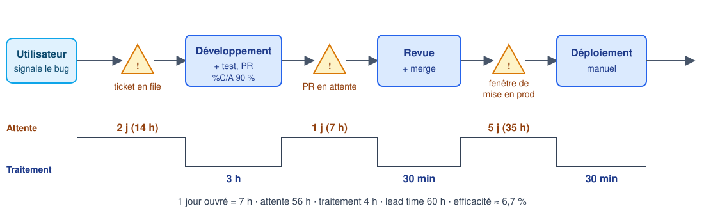

<!-- _class: lead -->
# Jour 1 — Culture DevOps & collaboration Git

**DevOps — Concepteur Développeur d'Applications**
CDA — ForEach Academy

Formateur : Fabrice Claeys

---

## Programme de la journée

| Horaire | Contenu |
|---------|---------|
| 9h00-9h20 | Accueil, tour de table, vérification des postes |
| 9h20-10h00 | **1.1 Pourquoi DevOps ?** — mur de la confusion, histoire, CALMS, boucle infinie |
| 10h00-10h30 | 🧪 **Exercice 1** — La Fromagerie : problèmes classés selon CALMS (TP 0, partie A) |
| 10h30-10h40 | *Pause* |
| 10h40-11h20 | **1.2 Agile, Lean et DevOps** — Scrum, Kanban, 7 gaspillages, flux, WIP, *Three Ways* |
| 11h20-11h50 | 🧪 **Exercice 2** — *Value stream mapping* de La Fromagerie |
| 11h50-12h10 | **1.3 Mesurer** — DORA, bénéfices, CI / livraison / déploiement continus, outils |
| 12h10-12h30 | 🧪 **Exercice 3** — Le pipeline cible de TaskFlow (TP 0, partie B) |
| 13h30-14h00 | **2.1 Git pour travailler en équipe** (rappel rapide) + 🎬 démo branches |
| 14h00-14h30 | **2.2 Workflows d'équipe** — GitHub Flow, Git Flow, trunk-based, PR, revue, rulesets |
| 14h30-16h45 | 🛠️ **TP 1** — Git en équipe (pause et 🎬 démo conflit incluses) |
| 16h45-17h00 | Débrief, quiz, récap |

---

## Objectifs de la journée

À la fin de la journée, vous saurez :

- **Expliquer** ce que DevOps change : culture, flux, mesure (et pas seulement des outils)
- **Relier** DevOps à l'Agile et au Lean : gaspillages, WIP, *value stream*, *Three Ways*
- **Mesurer** une équipe avec les 4 indicateurs **DORA** et calculer un *lead time*
- **Distinguer** intégration continue, livraison continue et déploiement continu
- **Contribuer** à un dépôt d'équipe « comme en entreprise » : ruleset, CODEOWNERS, PR, revue, conflit résolu

> Lien avec le titre CDA : bloc 3 « Préparer le déploiement d'une application sécurisée », dont la compétence **« Contribuer à la mise en production dans une démarche DevOps »**. Le dépôt TaskFlow de la semaine est une preuve directe pour votre dossier professionnel.

---

## La semaine en un coup d'œil

| Jour | Thème | Ce que TaskFlow gagne |
|---|---|---|
| **J1** | Culture DevOps, Git en équipe | Le pipeline cible (sur papier) et les règles de travail en équipe |
| **J2** | Git avancé, intégration continue | Dépôt protégé par un ruleset ; `ci.yml` : lint, tests unitaires + intégration (Postgres), build |
| **J3** | Déploiement continu, sécurité du pipeline | Images sur ghcr.io, scan Trivy, staging automatique, production après approbation, rollback |
| **J4** | Infrastructure as Code, monitoring | Staging décrit en OpenTofu ; Prometheus, Grafana, alerte, post-mortem |
| **J5** | DevSecOps (demi-groupes) | OWASP Top 10, Juice Shop, `security.yml` (gitleaks, audit, Semgrep, ZAP) |

**TaskFlow**, le fil rouge : front Vite servi par Nginx, API Node 20 + Express (`GET /health`), PostgreSQL 16. Dockerfiles et `compose.yaml` de dev **fournis** : vous les lisez et les modifiez, l'effort porte sur ce qui **entoure** le code.

> Fil conducteur : **on n'automatise que ce qu'on sait faire à la main**, et **la sécurité commence dès le premier pipeline**.

---

## Accueil : tour de table (10 min)

Chacun en 30 secondes :

1. Votre entreprise d'alternance (ou votre projet) : **comment le code part-il en production** aujourd'hui ?
2. Qui fait le déploiement ? Combien de fois par mois ? Que se passe-t-il quand ça casse ?
3. Une chose que vous aimeriez savoir faire **à la fin de la semaine**

> Le formateur note au tableau les réponses à la question 1 : on les reclassera avec CALMS et DORA dans la matinée.

---

## Vérification des postes

| Vérification | Commande | Résultat attendu |
|---|---|---|
| Git et identité | `git --version && git config user.email` | `git version 2.4x`, votre e-mail GitHub |
| Clé SSH GitHub | `ssh -T git@github.com` | `Hi <pseudo>! You've successfully authenticated…` |
| Docker + Compose | `docker run --rm hello-world && docker compose version` | `Hello from Docker!`, `v2.x` |
| Node | `node --version` | `v20.x` (ou 22) |
| OpenTofu | `tofu version` | `OpenTofu v1.x` |
| Ansible | `ansible --version` | `ansible [core 2.x]` |
| `gh` (facultatif) | `gh auth status` | `Logged in to github.com` |

> Une ligne rouge ? `ressources/setup-poste.md`, section correspondante. **Git et SSH sont bloquants dès cet après-midi**, Docker dès demain, OpenTofu et Ansible au J4.

---

<!-- _class: lead -->
# 1.1 Pourquoi DevOps ?

---

## Mise en situation : vendredi, 18h

> Léa a terminé sa fonctionnalité. « Ça marche sur ma machine. » Elle dépose un zip sur le partage réseau et prévient Karim, l'administrateur système.
> Karim copie les fichiers sur le serveur. Page blanche : il manquait une extension PHP, une variable de configuration et une migration de base.
> 2h du matin : retour à l'ancienne version, à la main. Lundi : réunion « **qui** a cassé la prod ? ».

À deux, 3 minutes :

- Listez **tout ce qui a mal tourné**. Combien de problèmes sont **techniques** ? Combien sont **organisationnels** ?
- Léa et Karim sont-ils incompétents ? Qu'est-ce qui, dans le **système**, a rendu l'incident probable ?

---

## Le « mur de la confusion »

```
        ÉQUIPE DEV                  ║║║                 ÉQUIPE OPS
   Objectif : CHANGER               ║║║          Objectif : STABILISER
   (livrer des fonctionnalités)     ║║║          (disponibilité, sécurité)
                                    ║║║
   « C'est fini, à vous ! »  ── zip ──▶  « Encore une livraison le vendredi… »
                                    ║║║
   Mesurée sur : le nombre de       ║║║          Mesurée sur : le nombre d'incidents
   fonctionnalités livrées          ║║║          et le temps de disponibilité
```

- Deux équipes, **deux incitations contradictoires** : chacune optimise son indicateur… contre l'autre
- Résultat : livraisons **rares**, donc **énormes**, donc **risquées**, donc encore plus rares (cercle vicieux)
- Le problème n'est pas technique : c'est un problème d'**organisation** et d'**objectifs**

---

## Petite histoire du DevOps

| Année | Événement |
|---|---|
| 2001 | **Manifeste Agile** : livrer souvent, en petits incréments… mais l'Ops n'est pas dans la pièce |
| 2008 | Andrew Shafer et Patrick Debois parlent d'« *Agile infrastructure* » à la conférence Agile 2008 |
| 2009 | Velocity : John Allspaw et Paul Hammond (Flickr), « **10+ deploys per day** » ; Debois lance les premiers **DevOpsDays** à Gand |
| 2010 | Livre *Continuous Delivery* (Jez Humble, David Farley) |
| 2013 | Roman ***The Phoenix Project*** (Gene Kim, Kevin Behr, George Spafford) : DevOps raconté comme un thriller d'entreprise |
| 2014+ | Rapports *State of DevOps*, puis équipe **DORA** ; livres *The DevOps Handbook* (2016) et ***Accelerate*** (2018) |

> **DevOps** = *Development* + *Operations*. Le mot vient du nom de la conférence de Gand.

---

## Ce qu'est (et n'est pas) DevOps

**C'est** une **culture** + des **pratiques** + des **outils** pour livrer des logiciels **vite** et **de façon fiable**, avec une responsabilité partagée de l'idée jusqu'à la production.

| DevOps n'est pas… | … mais plutôt |
|---|---|
| Un outil (« on a installé Jenkins, on est DevOps ») | Une façon de travailler que les outils facilitent |
| Un poste (« l'ingénieur DevOps s'en occupe ») | Une responsabilité **partagée** par toute l'équipe produit |
| Supprimer les Ops | Faire collaborer Dev, Ops (et Sécurité) **dès la conception** |
| Aller vite au détriment de la qualité | Aller vite **grâce** à la qualité : tests, automatisation, petits lots |

---

## CALMS : les 5 piliers

| Lettre | Pilier | Concrètement | Anti-pattern |
|---|---|---|---|
| **C** | **Culture** | Objectifs communs, post-mortem sans blâme, droit à l'erreur | « Qui a cassé la prod ? » |
| **A** | **Automatisation** | Tests, build, déploiement, infrastructure : tout ce qui est répétitif | La procédure Word de 12 pages |
| **L** | **Lean** | Petits lots, flux continu, limiter le travail en cours, chasser l'attente | La mise en prod mensuelle de 300 changements |
| **M** | **Mesure** | Indicateurs (DORA, monitoring) pour **s'améliorer**, pas pour punir | « On pense que ça va mieux » |
| **S** | **Partage** (*Sharing*) | Documentation, revue de code, retours d'incident publiés | Le seul qui sait, c'est Julien |

> CAMS : Damon Edwards et John Willis (2010) ; le **L** de Lean a été ajouté par Jez Humble. **Culture avant outils.**

---

## CALMS comme grille de diagnostic

Une question par pilier, à poser à n'importe quelle équipe :

| Pilier | Question | Réponse « saine » |
|---|---|---|
| Culture | Que se passe-t-il le lendemain d'un incident ? | Un post-mortem sans coupable, avec des actions |
| Automatisation | Combien d'étapes **manuelles** entre le merge et la prod ? | Zéro, ou un seul clic d'approbation |
| Lean | Combien de temps un changement **attend**-il sans que personne ne travaille dessus ? | Quelques heures, pas des semaines |
| Mesure | Connaissez-vous votre fréquence de déploiement et votre taux d'échec ? | Oui, chiffrés, et ils s'améliorent |
| Partage | Si la personne clé est absente, qui peut déployer ou réparer ? | N'importe qui dans l'équipe, grâce à la doc et au code |

> C'est exactement la grille de l'exercice 1.

---

## La boucle infinie

```
            ╭─────────── DEV ───────────╮      ╭──────────────── OPS ────────────────╮
          ╭─▶ PLAN ──▶ CODE ──▶ BUILD ──╮      ╭─▶ RELEASE ──▶ DEPLOY ──▶ OPERATE ──╮
          │                             ▼      │                                     │
          │                            TEST ───╯                                     │
          │                                                                          │
          ╰────────── retours : incidents, usages, métriques ◀── MONITOR ◀───────────╯
```

- Le symbole **∞** : la boucle ne s'arrête jamais, chaque tour livre **une petite amélioration**
- La moitié droite (Ops) **nourrit** la moitié gauche (Dev) : ce qu'on observe en production devient le prochain ticket
- La **sécurité** n'est pas une case : elle est présente à chaque étape (J3, J5)

---

## La boucle appliquée à TaskFlow (et à la semaine)

| Étape | Question | TaskFlow | Jour |
|---|---|---|---|
| **Plan** | Que faut-il faire, dans quel ordre ? | Issues GitHub, priorisées | J1, J4 |
| **Code** | Comment écrire à plusieurs sans se gêner ? | Branche, PR, revue, ruleset, CODEOWNERS | **J1**, J2 |
| **Build** | Comment fabriquer un artefact reproductible ? | `npm ci`, `npm run build`, images Docker | J2, J3 |
| **Test** | Est-ce que ça marche toujours ? | Lint, tests unitaires, tests d'intégration (Postgres) | J2 |
| **Release** | Quelle version livre-t-on ? | Image `ghcr.io/…:<sha>`, scan Trivy | J3 |
| **Deploy** | Comment la mettre en ligne sans geste manuel ? | Staging auto, production après approbation | J3, J4 |
| **Operate** | Comment la faire tourner ? | Nginx HTTPS, sauvegardes, infra en code | J3, J4 |
| **Monitor** | Comment savoir que tout va bien ? | `/health`, `/metrics`, Prometheus, Grafana, alertes | J4 |

---

## « You build it, you run it »

> « Vous l'avez construit, vous le faites tourner. » — Werner Vogels, CTO d'Amazon (2006)

| Avant | Avec DevOps |
|---|---|
| Le dev livre et passe au ticket suivant | Le dev suit son code jusqu'en prod, lit les logs et les métriques |
| L'Ops découvre l'application le jour J | L'Ops participe à la conception : configuration, sauvegardes, supervision |
| Une panne = « la faute à l'autre équipe » | Une panne = un problème **de l'équipe**, analysé sans blâme |
| La configuration vit dans la tête de quelqu'un | Elle vit dans des fichiers **versionnés** et **revus** (Dockerfile, workflows, IaC) |

**Question CDA** : quel est le **coût** de ce modèle pour le développeur ? (astreintes, compétences à acquérir, charge mentale) Comment l'équipe le compense-t-elle ?

---

## À retenir — 1.1

- DevOps est né du **mur** entre Dev (changer) et Ops (stabiliser) : un problème d'objectifs avant d'être un problème d'outils
- **CALMS** : Culture, Automatisation, Lean, Mesure, Partage ; la culture passe en premier
- Le cycle de vie est une **boucle** : ce qu'on observe en production nourrit la planification
- « *You build it, you run it* » : l'équipe produit est responsable de bout en bout

---

## 🧪 Exercice 1 — La Fromagerie (30 min)

→ `tp/tp0-cartographie-pipeline/README.md`, **partie A**

| Temps | Consigne |
|---|---|
| 8 min | Lecture **seul** du récit « La Fromagerie Durand », crayon en main : soulignez chaque problème |
| 15 min | En groupe de 3-4 : tableau d'au moins **12 problèmes**, chacun classé dans **un pilier CALMS** et **une étape de la boucle**, avec la pratique qui l'éviterait |
| 7 min | Restitution : chaque groupe donne **son pilier le plus en souffrance** et le justifie |

> Question de justification : si vous n'aviez le budget que pour **une seule** amélioration, laquelle et pourquoi ?

---

<!-- _class: lead -->
# 1.2 Agile, Lean et DevOps

---

## Le Manifeste Agile (2001)

Nous valorisons…

| Davantage… | … que |
|---|---|
| Les **individus et leurs interactions** | les processus et les outils |
| Un **logiciel opérationnel** | une documentation exhaustive |
| La **collaboration avec les clients** | la négociation contractuelle |
| L'**adaptation au changement** | le suivi d'un plan |

Deux des 12 principes, qui annoncent DevOps :
- « Notre plus haute priorité est de satisfaire le client en **livrant rapidement et régulièrement** des fonctionnalités à grande valeur ajoutée. »
- « Un **logiciel opérationnel** est la principale mesure d'avancement. »

---

## Où l'Agile s'arrête… et où DevOps prend le relais

```
   Besoin ──▶ [ Backlog ──▶ Sprint ──▶ Démo : « c'est fini ! » ] ──▶ ??? ──▶ Production
              └─────────── périmètre de l'Agile ─────────────┘     │
                                                                    └─ 3 semaines d'attente,
                                                                       recette, mise en prod
                                                                       mensuelle, par l'Ops
```

- L'Agile a **raccourci** la boucle côté développement : itérations de 1 à 4 semaines, feedback du client
- Mais « fini » ne voulait pas dire « **en production** » : le gain s'arrêtait au mur de la confusion
- **DevOps prolonge l'agilité jusqu'à la production** et jusqu'au retour des utilisateurs

> Définition de « fini » (*Definition of Done*) d'une équipe DevOps : **déployé en production et observé**.

---

## Scrum en une slide

```
  Product Backlog ──▶ Sprint Planning ──▶ ┌──── Sprint (1 à 4 semaines) ────┐ ──▶ Incrément
  (priorisé par le                        │   Daily Scrum (15 min / jour)    │     utilisable
   Product Owner)                         └──────────────────────────────────┘
                                                          │
                                         Sprint Review (démo) + Rétrospective (amélioration)
```

| Rôles | Événements | Artefacts |
|---|---|---|
| **Product Owner** : la valeur, l'ordre du backlog | Sprint, Planning, Daily, Review, **Rétrospective** | Product Backlog, Sprint Backlog, **Incrément** |
| **Scrum Master** : le cadre, lever les obstacles | (tous à durée fixe : *timebox*) | (chacun avec un engagement : objectif, but du sprint, *Done*) |
| **Developers** : réalisent l'incrément | | |

> Lien DevOps : la **rétrospective** est déjà de l'amélioration continue ; DevOps y ajoute des **mesures** de production.

---

## Kanban en une slide

```
  │ À faire       │ En cours (WIP ≤ 3) │ Revue (WIP ≤ 2) │ Déployé      │
  │───────────────│────────────────────│─────────────────│──────────────│
  │ [#42] [#43]   │ [#38] [#40]        │ [#37]           │ [#35] [#36]  │
  │ [#44] [#45]   │                    │                 │              │
                     ◀──── on TIRE une carte quand une place se libère ────
```

- **Visualiser** le flux : chaque colonne = une étape réelle, chaque carte = un élément de travail
- **Limiter le travail en cours** (*WIP limit*) : on finit avant de commencer
- **Flux tiré** : on prend du travail quand on a de la capacité, on ne le pousse pas
- **Mesurer** : *lead time* (temps de la carte de gauche à droite), débit (cartes terminées par semaine)

| | Scrum | Kanban |
|---|---|---|
| Cadence | Sprints à durée fixe | Flux continu |
| Changement de priorité | Au sprint suivant | À tout moment (hors colonnes en cours) |
| Proche de DevOps… | Par la rétrospective | Par le **flux** et le WIP : c'est du Lean appliqué |

---

## Lean : l'héritage de Toyota

Le **Lean** vient du système de production de Toyota (années 1950-1980), popularisé par Womack et Jones (*Lean Thinking*, 1996) :

1. Définir la **valeur** du point de vue du client
2. Cartographier la **chaîne de valeur** (*value stream*) : toutes les étapes de la demande à la livraison
3. Faire **circuler** (flux) : supprimer les attentes et les interruptions
4. **Tirer** : produire à la demande, pas sur stock
5. Viser la **perfection** : améliorer en continu (*kaizen*)

> Mary et Tom Poppendieck (*Lean Software Development*, 2003) ont traduit ces idées pour le logiciel : un code écrit mais **pas en production** est un **stock** qui ne rapporte rien et qui vieillit.

---

## Les 7 gaspillages appliqués au logiciel

| Gaspillage industriel | Équivalent logiciel (Poppendieck) | Exemple |
|---|---|---|
| Stocks | **Travail partiellement fait** | Branche de 3 semaines non fusionnée, code « fini » pas déployé |
| Surproduction | **Fonctionnalités en trop** | Le module d'export PDF que personne n'utilise |
| Surtraitement | **Réapprentissage** | Redécouvrir à chaque mise en prod la procédure jamais écrite |
| Transport | **Transferts** (*handoffs*) | Dev → recette → Ops : à chaque passage, de l'information se perd |
| Mouvements | **Changements de contexte** | Travailler sur 4 tickets en parallèle |
| Attente | **Délais** | La PR qui attend une revue 3 jours, la mise en prod mensuelle |
| Défauts | **Défauts** | Le bug trouvé par un client, qui coûte 10 fois plus que trouvé par un test |

> Un 8e gaspillage est souvent ajouté : le **talent inexploité** (l'apprenti qui n'ose plus rien proposer).

---

## Petits lots, WIP et loi de Little

**Loi de Little** : `lead time moyen = travail en cours (WIP) ÷ débit`

```
  Équipe A : 12 tickets en cours, en termine 4 par semaine  →  12 / 4 = 3 semaines d'attente
  Équipe B :  4 tickets en cours, en termine 4 par semaine  →   4 / 4 = 1 semaine
                    même effectif, même débit : seul le WIP a changé
```

- Commencer moins = **finir plus vite** (et changer moins souvent de contexte)
- Un **petit lot** traverse le flux plus vite, se relit mieux, se teste mieux, se répare mieux
- C'est la justification Lean de la PR **courte**, de l'intégration **quotidienne** et du déploiement **fréquent**

**Question** : votre équipe de TP 1 a 4 PR ouvertes et 1 relecteur disponible. Que faites-vous **avant** d'ouvrir une 5e PR ?

---

## Le *value stream mapping* (VSM)

Cartographier **toutes** les étapes entre la demande et la mise en production, et mesurer pour chacune :

| Mesure | Définition | Question à poser |
|---|---|---|
| **Temps de traitement** (*process time*, PT) | Temps où quelqu'un **travaille réellement** sur l'élément | « Si vous n'étiez jamais interrompu, combien de temps ? » |
| **Temps d'attente** | Temps où l'élément **attend** (file, validation, fenêtre de déploiement) | « Entre la fin de l'étape précédente et le début de la vôtre ? » |
| ***Lead time*** (LT) | Temps total vu par le client : somme des PT **et** des attentes | « Entre la demande et la mise en production ? » |
| **%C/A** (*complete & accurate*) | Part des éléments reçus sans devoir être corrigés ou redemandés | « Combien de fois devez-vous renvoyer le travail ? » |

**Efficacité du flux** = `Σ temps de traitement ÷ lead time`

> Dans le logiciel, une efficacité de **5 à 15 %** est courante : on ne gagne presque rien à travailler plus vite, tout à **attendre moins**.

---

## Exemple : corriger un bug de TaskFlow



Lead time = 56 h d'attente + 4 h de traitement = **60 h ouvrées** (environ 8,5 jours ouvrés) · efficacité = 4 / 60 ≈ **6,7 %**

**Question** : quelle attente supprimer **en premier** ? Avec quelle pratique de la semaine ?

---

## Les *Three Ways* (The Phoenix Project, The DevOps Handbook)

| Voie | Principe | Sens | Pratiques |
|---|---|---|---|
| **1. Le flux** | Accélérer le travail de gauche à droite (Dev → Ops → client) ; penser **système**, pas silo | ──▶ | Petits lots, WIP limité, intégration continue, déploiement automatisé |
| **2. Le feedback** | Renvoyer l'information de droite à gauche, **vite** et **tôt** | ◀── | Tests automatiques, PR et revue, monitoring, alertes, *andon* (« on arrête la chaîne quand c'est rouge ») |
| **3. L'apprentissage continu** | Expérimenter, prendre des risques mesurés, apprendre de chaque échec | ∞ | Post-mortem sans blâme, rétrospectives, temps dédié à l'amélioration, partage |

> Les trois voies sont **cumulatives** : on ne peut pas apprendre de son feedback si le flux met six semaines à le produire.

---

## À retenir — 1.2

- **Agile** a raccourci la boucle de développement ; **DevOps la prolonge jusqu'à la production**
- **Scrum** rythme le travail (sprints, rétrospective) ; **Kanban** fait circuler le flux (WIP, flux tiré)
- **Lean** : chasser les 7 gaspillages ; en logiciel, le pire est souvent l'**attente** et le **travail partiellement fait**
- **VSM** : lead time = traitement + attente ; efficacité du flux = traitement ÷ lead time
- **Three Ways** : flux, feedback, apprentissage continu

---

## 🧪 Exercice 2 — Value stream mapping (30 min)

→ `exercices/jour1/02-value-stream-mapping.md`

| Temps | Consigne |
|---|---|
| 5 min | Lire l'entretien avec Julien (La Fromagerie) : le parcours de la page « Plateau de fromages » |
| 10 min | Dessiner la carte : étapes, temps de traitement, attentes (papier ou tableau) |
| 7 min | Calculer le **lead time**, la somme des temps de traitement, l'**efficacité du flux** |
| 8 min | Proposer **3 améliorations** chiffrées, chacune rattachée à un gaspillage et à une pratique de la semaine |

> Question de justification : quelle amélioration a le **meilleur rapport gain / effort** ? Laquelle demande un changement de **culture** plutôt qu'un outil ?

---

<!-- _class: lead -->
# 1.3 Mesurer : DORA et bénéfices

---

## Les 4 métriques DORA

**DORA** (*DevOps Research and Assessment*) : programme de recherche (racheté par Google en 2018) qui étudie chaque année des milliers d'équipes.

| Métrique | Définition | Mesure… |
|---|---|---|
| **Fréquence de déploiement** | À quelle fréquence l'équipe déploie-t-elle en production ? | le débit |
| **Délai de mise en production des changements** (*lead time for changes*) | Temps entre le **commit** et sa **mise en production** | le débit |
| **Taux d'échec des changements** | % de déploiements qui provoquent une dégradation (rollback, correctif urgent) | la stabilité |
| **Temps de restauration** (*time to restore*) | Temps pour rétablir le service après un déploiement raté | la stabilité |

> Attention : le *lead time* DORA part du **commit**, celui du VSM part de la **demande**. Les deux sont utiles, ne les confondez pas.

---

## Vitesse et stabilité ne s'opposent pas

| Indicateur | Équipes « élite » | Équipes « faibles » |
|---|---|---|
| Fréquence de déploiement | À la demande, plusieurs fois **par jour** | Entre une fois par mois et une fois tous les six mois |
| Délai commit → prod | Moins d'**un jour** | Entre un et six **mois** |
| Taux d'échec | Autour de **5 %** | Bien plus élevé (souvent plusieurs dizaines de %) |
| Temps de restauration | Moins d'**une heure** | Une semaine ou plus |

*Ordres de grandeur des rapports State of DevOps / DORA (2019-2023). En 2017, les équipes les plus performantes déployaient 46 fois plus souvent, avec un délai 440 fois plus court, une restauration 96 fois plus rapide et 5 fois moins d'échecs.*

> Les meilleures équipes sont bonnes **sur les quatre à la fois** : la stabilité vient **des** petits changements fréquents, pas **malgré** eux. Une panne après 5 changements se trouve en minutes ; après 300, en jours. Ce qui est douloureux, faites-le **plus souvent**.

---

## Mesurer DORA sur TaskFlow (en fin de semaine)

| Métrique | Où trouver la donnée | Commande / écran |
|---|---|---|
| Fréquence de déploiement | Exécutions réussies du job `deploy-production` | Onglet *Actions* → filtre sur `release.yml`, ou *Deployments* de l'environment `production` |
| Délai commit → prod | Date du commit vs date du déploiement | `git log -1 --format=%ci <sha>` et l'horodatage du job |
| Taux d'échec | Déploiements suivis d'un rollback (`workflow_dispatch`) | Nombre de rollbacks ÷ nombre de déploiements |
| Temps de restauration | Début de l'alerte → retour au vert | Alertmanager (J4) et votre post-mortem |

> Vous mesurerez votre **délai merge → prod** au débrief du J3 : gardez l'œil sur l'horloge.

---

## CI, livraison continue, déploiement continu

| | Intégration continue | Livraison continue | Déploiement continu |
|---|---|---|---|
| Sigle | **CI** | **CD** (*Continuous Delivery*) | **CD** (*Continuous Deployment*) |
| Idée | Intégrer **souvent** (au moins chaque jour) dans `main`, chaque changement **vérifié automatiquement** | Chaque version vérifiée est **déployable à tout moment** | Chaque version vérifiée part **en production sans humain** |
| Automatisé | Lint, tests, build | + artefact versionné, déploiement en staging | + déploiement en production |
| Humain avant la prod ? | — | **Oui** : une décision (un clic) | **Non** |
| Prérequis | Tests automatiques fiables | CI + artefact immuable + environnements | Livraison continue + forte confiance + monitoring |
| Cette semaine | J2 : `ci.yml` | J3 : environment `production` **avec approbation** | J3 : la même chose **sans** approbation |

> Première définition : on y revient en détail au J3. Retenez que la différence entre les deux « CD » est **l'humain**.

---

## Panorama des outils de la semaine

| Étape | Cette semaine | Alternatives du marché |
|---|---|---|
| Plan | GitHub Issues | Jira, GitLab Issues, Linear |
| Code | **Git + GitHub** (PR, rulesets, CODEOWNERS) | GitLab, Bitbucket, Gitea |
| Build / conteneurs | npm, **Docker + Compose** | Podman, Buildah, Kaniko |
| CI | **GitHub Actions** ; lecture de **Jenkins** et **GitLab CI** | CircleCI, Azure Pipelines |
| Release | **ghcr.io**, tags Git, GitHub Releases | Docker Hub, Harbor, Nexus |
| Deploy | Runner **self-hosted** + GitHub Environments | ArgoCD, Flux, Ansible, Kubernetes |
| IaC | **OpenTofu** (provider Docker), **Ansible** | Terraform, Pulumi, CloudFormation |
| Monitor | **Prometheus**, **Grafana**, Alertmanager | Datadog, Loki, Sentry, Uptime Kuma |
| Sécurité | **gitleaks**, Dependabot, **Trivy**, Semgrep, **ZAP** | Snyk, SonarQube, CodeQL, Burp Suite |

---

## Le pipeline cible de TaskFlow

```
 Développeur ─▶ branche ─▶ Pull Request ─▶ ci.yml (J2) : api · api-integration (Postgres) · front
                                │                 │ rouge → merge bloqué (ruleset : checks requis)
                    revue (1 pair, CODEOWNERS)    ▼ vert
                                └──────▶ merge sur main
                                            │
                     release.yml (J3) : build images ─▶ ghcr.io/<owner>/taskflow-api|front:<sha7>
                                            │            Trivy : CRITICAL → rouge
                                            ▼
              deploy-staging (runner self-hosted, auto) ─▶ http://localhost:8081 ─▶ smoke test /health
                                            │                       (recréé en OpenTofu au J4)
                                            ▼  approbation humaine (environment « production »)
              deploy-production ─▶ https://taskflow.localhost (Nginx 443) ─▶ smoke test /health
                                            │
              Prometheus · Grafana · Alertmanager (J4) ◀──── /metrics, sonde /health
              security.yml (J5) : gitleaks · npm audit · Semgrep · ZAP
```

---

## 🧪 Exercice 3 — Le pipeline cible (20 min)

→ `tp/tp0-cartographie-pipeline/README.md`, **partie B**

| Temps | Consigne |
|---|---|
| 12 min | En groupe : dessiner **votre** pipeline cible de TaskFlow (papier, Excalidraw ou mermaid), en partant du gabarit |
| 8 min | Restitution rapide : 1 minute par groupe, **un** choix justifié |

Le schéma doit faire apparaître : les **étapes**, les **outils**, les **déclencheurs**, **qui fait quoi** (humain / machine), les **contrôles** (où le pipeline s'arrête en rouge) et **les métriques DORA** que vous pourrez y lire.

> Gardez la photo : elle deviendra `docs/ARCHITECTURE.md`.

---

<!-- _class: lead -->
# Après-midi — Git en équipe

**2.1 Git pour travailler en équipe** (rappel rapide)

---

## Le modèle mental : 4 zones

```
   Répertoire de travail     Index (staging)        Dépôt local           Dépôt distant
  ┌──────────────────┐     ┌──────────────────┐    ┌──────────────────┐   ┌──────────────────┐
  │ app.js     (M)   │     │ app.test.js      │    │ a1b2c3d feat: …  │   │ a1b2c3d feat: …  │
  └──────────────────┘     └──────────────────┘    └──────────────────┘   └──────────────────┘
       git add / add -p ─────────▶  git commit ─────────────▶  git push ─────────────▶
       ◀──── git restore      ◀──── git restore --staged          ◀──── git fetch / pull
```

| Je veux… | Commande |
|---|---|
| Voir ce qui va partir dans le commit | `git diff --staged` |
| Ne commiter **qu'une partie** d'un fichier | `git add -p` |
| Récupérer le distant **sans** toucher à mes fichiers | `git fetch` (puis `git log origin/main`) |

- **Commit** = instantané + pointeur vers son (ses) parent(s) ; **branche** = fichier de 41 octets contenant un SHA ; **HEAD** = « vous êtes ici »
- Conséquence : une branche ne coûte rien, et perdre un commit est très difficile (`git reflog`, exercice 1.4)

---

## Conventional Commits

```
<type>(<portée optionnelle>)<! si rupture>: <description à l'impératif, en minuscules>

<corps optionnel : POURQUOI ce changement, pas comment>

<pied optionnel : BREAKING CHANGE: …, Refs: #42>
```

| Type | Usage | Effet SemVer (J2) |
|---|---|---|
| `feat` | Nouvelle fonctionnalité | MINEUR |
| `fix` | Correction de bug | CORRECTIF |
| `feat!` ou pied `BREAKING CHANGE:` | Changement incompatible | MAJEUR |
| `docs`, `style`, `refactor`, `perf`, `test`, `build`, `ci`, `chore` | Le reste | — |

```text
feat(api): permet de filtrer les tâches terminées

Les utilisateurs avec plus de 50 tâches ne retrouvaient plus les tâches à faire.

Refs: #42
```

---

## Faire respecter la convention

Une convention que rien ne vérifie finit par ne plus être respectée (pilier **A** de CALMS).

| Niveau | Outil | Quand |
|---|---|---|
| Poste du développeur | Hook Git `commit-msg` (fourni dans le TP 1 : `.githooks/commit-msg`) | À chaque commit |
| Pull Request | Titre de PR conventionnel (c'est lui qui devient le message en *squash merge*) | À la revue |
| CI | `commitlint` ou une action qui vérifie le titre de PR | J2 |

```console
$ git commit -m "modif"
✖ Message refusé : il ne respecte pas Conventional Commits.
  Attendu : <type>(<portée>): <description>   ex. feat(api): ajoute la route /health
```

> Un hook local se contourne (`--no-verify`) : c'est un **confort**, la vraie garantie est côté serveur (CI, ruleset).

---

## `.gitignore` et secrets

```gitignore
node_modules/
dist/
coverage/
.env
*.log
```

```console
$ git check-ignore -v .env          # pourquoi ce fichier est-il ignoré ?
.gitignore:4:.env       .env
$ git rm --cached .env              # il était déjà suivi : on arrête de le suivre
```

> Un secret poussé une fois est **compromis pour toujours** : il reste dans l'historique, dans les clones, dans les forks. Le supprimer ne suffit pas : on le **révoque** et on le **change**. Outillage (gitleaks) au J3.

---

## Lire un historique comme un pro

| Question | Commande |
|---|---|
| Quel est le graphe de toutes les branches ? | `git log --oneline --graph --all` |
| Que contient ma branche que `main` n'a pas ? | `git log --oneline main..feature/x` |
| Qu'est-ce qui a été fusionné dans `main`, PR par PR ? | `git log --oneline --first-parent main` |
| Quelles branches sont déjà fusionnées ? | `git branch --merged main` |
| Quand cette chaîne de caractères est-elle apparue ? | `git log -S "DATABASE_URL" --oneline` |
| Qui a écrit cette ligne, dans quel commit ? | `git blame -L 10,20 api/src/app.js` |
| Où ma branche a-t-elle divergé de `main` ? | `git merge-base main feature/x` |

> Alias recommandé : `git config --global alias.lg "log --oneline --graph --all --decorate"`
> Entraînement : `exercices/jour1/03-lire-historique.md`

---

## Fusionner : trois stratégies



| Stratégie | Résultat dans `main` | Bouton GitHub |
|---|---|---|
| **Fast-forward** | `main` avance sur les commits de la branche, aucun commit ajouté | (seulement en local ou *Rebase and merge*) |
| **Commit de fusion** | Un commit à **deux parents** garde la trace de la branche | *Create a merge commit* |
| **Squash** | **Un seul** commit contenant toute la PR, message = titre de la PR | *Squash and merge* |

> Choix de la semaine : **squash** sur `main` (une PR = un commit conventionnel), historique linéaire. Rebase en détail demain.

---

## 🎬 Démo — Branches et fusions

`demos/demo-git-branches/`

1. Une branche = un pointeur : `cat .git/refs/heads/feature/health`
2. Fusion **fast-forward**
3. Branches divergentes, **commit de fusion** à deux parents
4. **Squash** : `git merge --squash`, un seul commit, la branche n'est pas « fusionnée » aux yeux de Git
5. Lecture du graphe à chaque étape

> Question à la salle avant chaque `git log --graph` : **dessinez le graphe que vous attendez**.

---

<!-- _class: lead -->
# 2.2 Workflows d'équipe

---

## GitHub Flow

```
  main  ──●──────────●───────────────●──────────────●──▶   toujours déployable
           \        ▲ \             ▲ \            ▲
            ●──●──●┘   ●──●────────┘   ●──●──●────┘
            feat/a     fix/b           feat/c
            (PR #1)    (PR #2)         (PR #3)
```

1. Une branche **courte** depuis `main` (quelques heures à 2 jours)
2. Commits, push, **Pull Request** tôt (éventuellement en *draft*)
3. CI verte + revue approuvée → **merge** dans `main`
4. `main` est **déployée** (automatiquement ou presque)

> Simple, adapté aux applications web livrées en continu. **C'est le workflow de la semaine.**

---

## Git Flow

```
  main      ──●─────────────────────────────●─────────●──▶   versions livrées (tags)
               \                           ▲ \       ▲
  hotfix/*      \                          │  ●─────┤        correctif urgent
                 \           release/1.2 ──●        ▼
  develop         ●──────●─────────●──────/─────────●──▶     intégration
                   \    ▲ \       ▲
  feature/*         ●──●┘  ●──●──●┘                          fonctionnalités
```

- `main` = versions livrées ; `develop` = intégration ; `release/*` = stabilisation ; `hotfix/*` = urgences
- Pensé (Vincent Driessen, 2010) pour des **versions planifiées** : logiciel installé chez le client, application mobile, plusieurs versions maintenues
- Coût : branches **longues**, fusions fréquentes entre branches, intégration **retardée**

---

## Trunk-based development

```
  main (trunk) ──●──●──●──●──●──●──●──●──●──●──●──▶   tout le monde intègre au moins une fois par jour
                  \ ▲  \▲     \ ▲
                   ●    ●      ●     branches de quelques heures (ou commits directs, en binôme)
```

- Branches **très courtes** (moins d'un jour), intégration **continue** au sens strict
- Le code non terminé est livré **désactivé** grâce aux ***feature flags*** (J3)
- Exige une CI **rapide et fiable** et des tests solides : c'est la pratique des équipes « élite » DORA
- Les *releases* sont des tags (ou des branches de release courtes) sur le tronc

---

## Quel workflow, pour quelle équipe ?

| | GitHub Flow | Git Flow | Trunk-based |
|---|---|---|---|
| Branches longues | `main` | `main` + `develop` (+ `release/*`) | `main` |
| Durée de vie d'une branche | Heures à jours | Jours à semaines | **Heures** |
| Fréquence d'intégration | Par PR | Par fin de fonctionnalité | **Continue** |
| Compatible déploiement continu | Oui | Difficilement | Oui, c'est sa raison d'être |
| Exige | CI + revue | Discipline de fusion | CI excellente, feature flags, tests solides |
| Idéal pour | Applications web, SaaS | Logiciels versionnés, plusieurs versions en parallèle | Équipes matures, gros volumes de changements |

**Lien avec la CI** : plus une branche vit longtemps, moins l'intégration est « continue ». Une CI qui tourne sur une branche de trois semaines **n'est pas** de l'intégration continue.

---

## La Pull Request : anatomie

| Élément | Bonne pratique |
|---|---|
| **Titre** | Conventionnel, il deviendra le message du commit squashé : `feat(api): ajoute la pagination` |
| **Description** | **Quoi** et surtout **pourquoi** ; lien vers l'issue (`Closes #42`) ; comment tester |
| **Template** | `.github/pull_request_template.md` pré-remplit la description (checklist commune) |
| **Taille** | Petite : moins de 300-400 lignes ; au-delà, la qualité de la revue s'effondre |
| **Statut** | *Draft* tant que ce n'est pas prêt ; *Ready for review* ensuite |
| **Checks** | La CI tourne sur la PR ; une PR rouge ne mérite pas encore de revue humaine |

> `Closes #42` dans la description ferme l'issue automatiquement au merge : la boucle *plan → code* est tracée.

---

## La revue de code : quoi regarder ?

| Priorité | Question | Exemple |
|---|---|---|
| 1 | Le changement fait-il **ce que la PR annonce** ? | « La suppression marche, mais le compteur ne se met pas à jour » |
| 2 | Est-il **correct** et **sûr** ? (cas limites, erreurs, secrets, injections) | « Le titre n'est pas validé côté API : une chaîne vide passe » |
| 3 | Est-il **testé** ? | « Un test sur le 404 de `DELETE /api/tasks/:id` serait utile » |
| 4 | Est-il **lisible** et **maintenable** ? | « Extraire cette requête dans le repository, comme les autres » |
| 5 | Le style ? | → le **linter** s'en charge, pas l'humain |

- Relisez **petit** et **vite** : une PR qui attend 3 jours, c'est le gaspillage « attente »
- La revue sert aussi à **partager** la connaissance (pilier S de CALMS)

---

## *Conventional comments*

Format : `<label> [décorations]: <sujet>` — l'intention du commentaire est **explicite**.

| Label | Sens | Exemple |
|---|---|---|
| `praise:` | Ce qui est bien (au moins un par revue !) | `praise: le test du cas 503 est très clair.` |
| `issue (blocking):` | Problème à corriger avant le merge | `issue (blocking): le .env est inclus dans la PR.` |
| `suggestion:` | Proposition d'amélioration | `suggestion (non-blocking): renommer x en taskTitle ?` |
| `question:` | Demande d'explication, pas un reproche | `question: pourquoi un timeout de 30 s ici ?` |
| `nitpick:` | Détail, toujours non bloquant | `nitpick: espace en trop ligne 12.` |
| `todo:` / `chore:` | Petite tâche nécessaire | `todo: mettre à jour le README.` |
| `thought:` / `note:` | Réflexion, information | `thought: on pourrait mutualiser avec /health plus tard.` |

> Source : conventionalcomments.org. Avantage : l'auteur sait **immédiatement** ce qui bloque et ce qui est facultatif.

---

## Commenter avec bienveillance… et efficacité

| À éviter | À préférer |
|---|---|
| « C'est faux. » | `issue (blocking): si la liste est vide, tasks[0] lève une erreur. On renvoie [] ?` |
| « Pourquoi tu as fait ça ?? » | `question: qu'est-ce qui a motivé ce choix ? Je ne vois pas le cas d'usage.` |
| « Illisible. » | `suggestion: découper cette fonction en deux (validation / enregistrement) ?` |
| Rien de positif | `praise: bien vu pour la gestion du 404.` |

Sur GitHub, dans un commentaire de ligne, le bouton **Add a suggestion** propose directement le code ; l'auteur l'applique en un clic (*Commit suggestion*) :

```text
suggestion (non-blocking): nom plus explicite
    [bloc suggestion]  const taskTitle = req.body.title.trim();
```

> Parlez du **code**, pas de la personne. *Approve*, *Comment* ou *Request changes* : choisissez en conscience.

---

## Protéger `main` : les rulesets

**Settings → Rules → Rulesets → New branch ruleset** (remplace les « branch protection rules » classiques)

| Règle | Effet |
|---|---|
| *Enforcement status : Active*, cible : *Default branch* | La règle s'applique à `main` |
| *Bypass list* vide | Personne ne contourne, **pas même les administrateurs** |
| *Restrict deletions* / *Block force pushes* | `main` ne peut être ni supprimée ni réécrite |
| *Require a pull request before merging* : **1** approbation | Tout passe par une PR relue |
| ↳ *Dismiss stale approvals*, *Require review from Code Owners*, *Require conversation resolution* | Un nouveau push annule l'approbation ; les propriétaires du code relisent ; aucun commentaire laissé sans réponse |
| ↳ *Allowed merge methods* : **Squash** | Une PR = un commit |
| *Require status checks to pass* | Dès que la CI existe (**demain**) |

> Gratuit sur les dépôts **publics** (dépôts privés : offre payante). Avantages sur l'ancien système : plusieurs rulesets cumulables, ciblage par motif (`main`, `release/*`), visibles par tous les contributeurs (`gh ruleset check main`).

---

## Ce que voit celui qui force

```console
$ git push origin main
remote: error: GH013: Repository rule violations found for refs/heads/main.
remote: Review all repository rules at https://github.com/<owner>/<repo>/rules?ref=refs%2Fheads%2Fmain
remote:
remote: - Changes must be made through a pull request.
remote:
To github.com:<owner>/<repo>.git
 ! [remote rejected] main -> main (push declined due to repository rule violations)
```

- C'est **voulu** : la règle remplace le « faites attention » par un contrôle automatique
- Si le push **passe** : vous êtes dans la *bypass list*, le ruleset est *Disabled*, ou il ne cible pas `main`

---

## CODEOWNERS

Fichier `.github/CODEOWNERS` : **qui doit relire** quels fichiers.

```text
# Le DERNIER motif qui correspond l'emporte
*                       @alice                 # par défaut : la mainteneuse
/.github/               @alice                 # la configuration du dépôt et de la CI
/api/                   @bob @chloe            # l'équipe back
/front/                 @david
/infra/  /monitoring/   @alice @bob            # l'exploitation est partagée
*.md                    @chloe                 # la documentation
```

- GitHub **demande automatiquement** la revue des propriétaires concernés à l'ouverture de la PR
- Avec *Require review from Code Owners*, l'approbation d'**un propriétaire** est **obligatoire**
- Les propriétaires doivent avoir un accès en **écriture** ; une équipe s'écrit `@org/nom-equipe`
- Piège : un seul propriétaire pour un fichier qu'il modifie lui-même → il ne peut pas s'approuver : **toujours au moins deux**

---

## Conflits : ce qui change quand on est plusieurs

```console
$ git config --global merge.conflictStyle zdiff3      # affiche AUSSI la version d'origine
```

```html
<<<<<<< HEAD
    <h1 class="hero__title">La promo CDA</h1>
||||||| a1b2c3d            ← ancêtre commun (zdiff3)
    <h1 class="hero__title">La promo</h1>
=======
    <h1 class="hero__title">Promo CDA : nos projets</h1>
>>>>>>> main
```

- **Conflit textuel** (deux lignes ajoutées au même endroit) : on garde souvent les deux
- **Conflit sémantique** (deux intentions différentes) : ce n'est **pas** à Git ni à vous seul de trancher → on **parle** à l'autre auteur
- Pendant le conflit : `git diff` (le conflit seul), `git log --merge` (les commits en cause), `git merge --abort` (tout annuler)
- Après : relancer les tests, relire le fichier **en entier**, demander une nouvelle revue

---

<!-- _class: lead -->
# 🛠️ TP 1 — Git en équipe

`tp/tp1-git-collaboratif/`

---

## TP 1 — Déroulé (2h15)

Par équipes de 3-4 : un dépôt partagé, le site « Promo CDA », une carte par apprenant.

| # | Étape | Durée |
|---|---|---|
| 1 | Rôles, création du dépôt depuis le starter, invitations | 10 min |
| 2 | **Ruleset** sur `main` (PR + 1 revue + Code Owners + squash), test du refus | 15 min |
| 3 | **CODEOWNERS** livré… par une première PR relue | 15 min |
| 4 | Hook `commit-msg`, branche, carte, **commits conventionnels** | 15 min |
| 5 | PR avec le **template** | 10 min |
| — | *Pause* | 10 min |
| 6 | Revue croisée en ***conventional comments*** + suggestion + *Request changes* | 20 min |
| — | 🎬 Démo conflit (formateur) | 10 min |
| 7 | Squash and merge, **conflit textuel** résolu en local | 15 min |
| 8 | **Conflit sémantique** provoqué : négocier, résoudre, re-relire | 15 min |

---

## 🎬 Démo — Un conflit, de A à Z

`demos/demo-git-conflit/`

1. Deux branches ajoutent une ligne au même endroit : **conflit textuel**, on garde les deux
2. `git status --short` → `UU` ; lecture des marqueurs **avec** `zdiff3` (on voit l'ancêtre commun)
3. Deux branches changent **le même titre** différemment : **conflit sémantique**, il faut décider
4. `git merge --abort`, puis on recommence proprement
5. Vérifier : aucun marqueur restant (`git diff --check`), graphe final

> Juste avant l'étape 7 du TP : vous allez vivre exactement ces deux situations.

---

## TP 1 — Critères de réussite

- [ ] Un push direct sur `main` est **refusé** (`GH013`), administrateur compris
- [ ] `.github/CODEOWNERS` est arrivé par une PR **approuvée** ; GitHub demande automatiquement la revue des propriétaires
- [ ] Chaque membre a une PR **revue** (au moins un `praise:`, une `suggestion:` ou `issue:`, une conversation résolue) et **fusionnée en squash**
- [ ] Tous les commits de `main` respectent Conventional Commits (`git log --oneline main`)
- [ ] Un conflit **textuel** et un conflit **sémantique** ont été résolus, sans marqueur restant dans `main`

> Si ça ne marche pas : `git status` d'abord (il dit presque toujours quoi faire), puis l'aide-mémoire en fin d'énoncé, puis le formateur.

---

## Débrief (15 min)

1. Qu'est-ce qui a **coincé** ? Un problème d'outil, de règle… ou de **communication** ?
2. Combien de temps vos PR ont-elles **attendu** une revue ? Quel gaspillage Lean ?
3. Le ruleset vous a-t-il bloqué à tort ? Quelle règle enlèveriez-vous, et quel **risque** accepteriez-vous ?
4. Le conflit sémantique : qui a tranché ? Sur quel critère ?
5. Demain, la CI ajoutera des **checks requis** : que vérifierait-elle automatiquement que vous avez vérifié **à la main** aujourd'hui ?

---

## Récap de la journée

| Bloc | L'essentiel |
|---|---|
| 1.1 Pourquoi DevOps | Le mur Dev / Ops ; **CALMS** ; la boucle infinie ; « *you build it, you run it* » |
| 1.2 Agile, Lean, DevOps | DevOps prolonge l'Agile jusqu'à la prod ; 7 gaspillages ; WIP ; **VSM** ; *Three Ways* |
| 1.3 Mesurer | **DORA** : 2 de débit, 2 de stabilité ; CI ≠ livraison continue ≠ déploiement continu |
| 2.1 Git en équipe | 4 zones ; branche = pointeur ; **Conventional Commits** ; ff / merge / squash |
| 2.2 Workflows | GitHub Flow, Git Flow, trunk-based ; PR et revue en *conventional comments* ; **ruleset** ; **CODEOWNERS** |
| TP 1 | Le cycle complet en équipe, deux types de conflits |

---

## Quiz — 5 questions

1. Que signifient les lettres de **CALMS** ? Lequel des piliers est le plus difficile à acheter ?
2. Un changement demande 3 h de travail effectif mais met 15 jours ouvrés (de 7 h) à arriver en production. Quelle est l'**efficacité du flux** ?
3. Citez les **4 métriques DORA**, en séparant débit et stabilité.
4. Quelle est la différence entre **livraison continue** et **déploiement continu** ?
5. Vous êtes le seul propriétaire de `/api/` dans `CODEOWNERS` et la règle *Require review from Code Owners* est active. Vous ouvrez une PR qui modifie `/api/`. Que se passe-t-il, et comment le corriger ?

> 3 minutes, seul, par écrit. Puis on corrige ensemble.

---

## Quiz — Réponses

1. **C**ulture, **A**utomatisation, **L**ean, **M**esure, partage (**S**haring). La **culture** : elle ne s'installe pas avec un outil
2. Lead time = 15 × 7 = 105 h ; efficacité = 3 / 105 ≈ **2,9 %** : le problème est l'**attente**, pas la vitesse de développement
3. Débit : **fréquence de déploiement**, **délai commit → prod**. Stabilité : **taux d'échec des changements**, **temps de restauration**
4. Livraison continue : chaque version est déployable, **un humain décide** de la mise en prod. Déploiement continu : **aucun humain**, tout ce qui est vert part en prod
5. La PR est **bloquée** : on ne peut pas approuver sa propre PR et aucun autre propriétaire n'existe. Correction : **au moins deux propriétaires** par chemin (ou une équipe `@org/equipe`)

<!--
Notes formateur : question 2, faire remarquer que doubler la vitesse de développement (1,5 h au lieu de 3 h) ferait passer le lead time de 105 h à 103,5 h : moins de 2 % de gain. Question 5 : c'est le piège vécu (ou évité) à l'étape 3 du TP 1.
-->

---

## Pour aller plus loin (seul, ce soir ou pendant le TP si vous êtes en avance)

| Exercice | Durée | Contenu |
|---|---|---|
| `exercices/jour1/01-classement-calms.md` | 10 min | 12 situations d'entreprise à classer par pilier |
| `exercices/jour1/03-lire-historique.md` | 15 min | Lire un graphe, `main..feature`, `--first-parent`, `merge-base` |
| `exercices/jour1/04-reparer-ses-erreurs.md` | 25 min | `restore`, `reset` (soft / mixed / hard), `revert`, `reflog` : retrouver un commit « perdu » |

Lectures : *The Phoenix Project* (roman, se lit comme un thriller) ; *Accelerate* (les preuves derrière DORA) ; conventionalcomments.org ; conventionalcommits.org.

Antisèche : `ressources/cheatsheet-git.md`

---

<!-- _class: lead -->
# Demain : l'intégration continue

**Rebase et historique propre, SemVer et tags** — puis **GitHub Actions** : chaque PR de TaskFlow vérifiée automatiquement (lint, tests unitaires, tests d'intégration avec Postgres, build), et `main` protégée par des **checks requis**

Avant demain : `docker compose version` doit fonctionner sur votre poste

**Questions ?**
