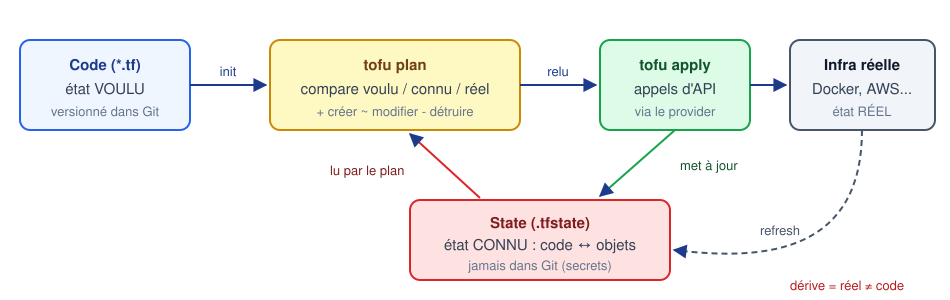
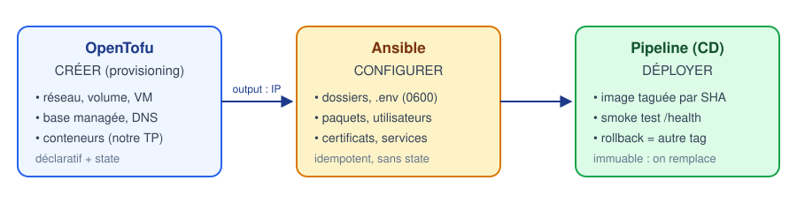
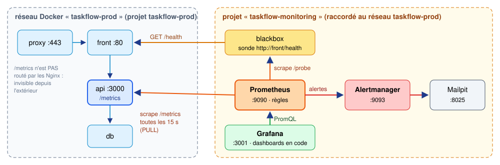
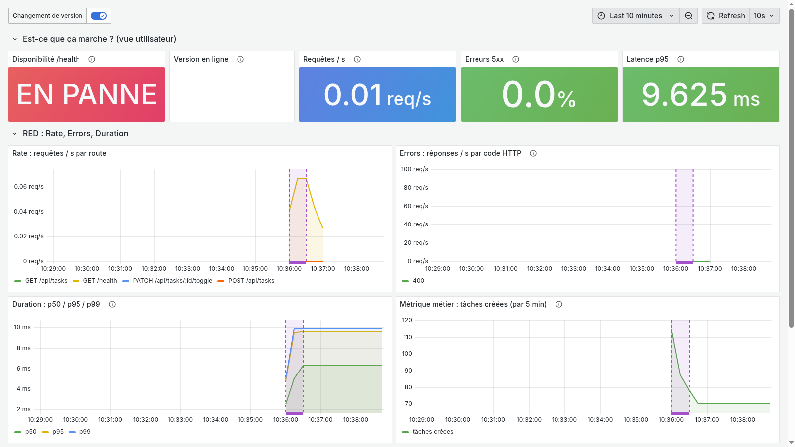
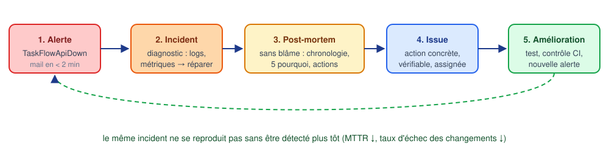

<!-- _class: lead -->
# Jour 4 — Infrastructure as Code & monitoring

**DevOps — Concepteur Développeur d'Applications**
CDA — ForEach Academy

Formateur : Fabrice Claeys

---

## Programme de la journée

| Horaire | Contenu |
|---------|---------|
| 9h00-9h30 | **5.1 Pourquoi l'IaC ?** — serveurs « flocons de neige », dérive, déclaratif vs impératif |
| 9h30-10h30 | **5.2 OpenTofu / Terraform** — providers, ressources, variables, state, plan, drift, modules + 🎬 démo |
| 10h30-11h15 | 🧪 **Exercices 4.1 à 4.3** — Nginx en code, dérive provoquée, lire un plan (pause incluse) |
| 11h15-11h45 | **5.3 Ansible** — inventaire, playbook, modules, idempotence, handlers, Jinja2 + 🎬 démo |
| 11h45-12h15 | 🧪 **Exercice 4.4** — Playbook qui prépare un dossier de déploiement |
| 12h15-12h30 | **Synthèse** — Tofu crée, Ansible configure ; l'IaC dans le pipeline |
| 13h30-14h30 | 🛠️ **TP étape 3** — Le staging de TaskFlow en OpenTofu + `iac.yml` |
| 14h30-15h00 | **6.1 Surveiller et apprendre** — logs, métriques, traces, RED/USE, Prometheus, alertes + 🎬 démo |
| 15h00-16h45 | 🛠️ **TP étape 4** — `/metrics`, Prometheus, Grafana, alerte, `jq`, **incident** (pause incluse) |
| 16h45-17h00 | Débrief, quiz, récap |

---

## Objectifs de la journée

À la fin de la journée, vous saurez :

- **Justifier** l'Infrastructure as Code : reproductibilité, revue, traçabilité, fin de la dérive
- **Décrire** un environnement avec OpenTofu, **lire un plan** avant de l'appliquer, **détecter une dérive**
- **Expliquer** le rôle du **state**, et pourquoi il ne va jamais dans Git
- **Écrire** un playbook Ansible **idempotent** et dire quand préférer Ansible à Tofu
- **Instrumenter** une API (méthode RED), **collecter** avec Prometheus, **visualiser** avec Grafana, **alerter**
- **Mener** un incident jusqu'au **post-mortem sans blâme** et à l'**issue d'amélioration**

> Titre CDA, bloc 3 : « Préparer le déploiement d'une application sécurisée ». Un staging décrit en code et une supervision avec alerte sont deux preuves fortes pour le dossier professionnel.

---

## Où en est TaskFlow ?

| Jour | Ce que TaskFlow a gagné |
|---|---|
| J2 | CI : lint, tests unitaires + intégration, build, checks requis |
| J3 | CD : images ghcr.io, Trivy, **staging** automatique (Compose), **production** après approbation, rollback |
| **J4 matin** | le staging n'est plus un `compose.staging.yaml` copié à la main : il est **décrit en code** et **vérifié en PR** |
| **J4 après-midi** | la prod **se mesure** : métriques, tableau de bord, **alerte**, post-mortem |
| J5 | DevSecOps : SAST, DAST, dépendances, secrets |

```
  PLAN ─▶ CODE ─▶ BUILD ─▶ TEST ─▶ RELEASE ─▶ DEPLOY ─▶ OPERATE ─▶ MONITOR ─╮
   ▲                                          ▲▲▲▲▲▲              ▲▲▲▲▲▲▲  │
   │                                     ce matin (IaC)      cet après-midi │
   ╰────────────────────── retour d'information (feedback) ◀────────────────╯
```

---

<!-- _class: lead -->
# 5.1 Pourquoi l'IaC ?

*Infrastructure as Code : l'infrastructure décrite dans des fichiers texte, versionnés, relus et exécutés par un outil.*

---

## Mise en situation : « le serveur de Patrick »

L'application tourne depuis 4 ans sur `srv-prod-01`. Patrick l'a installé, puis :

- a ajouté un `apt install` « en urgence » un soir, il y a trois ans ;
- a changé la taille du *pool* de connexions directement dans `/etc/...` ;
- a ouvert un port dans le pare-feu « pour tester » ;
- est parti dans une autre entreprise.

Le disque lâche. **Question à la salle** : combien de temps pour reconstruire un serveur **identique** ? Comment savoir ce qu'il contenait ?

> Un **serveur flocon de neige** (*snowflake server*) : unique, fragile, impossible à reproduire. On n'ose plus le toucher, donc on ne le met plus à jour.

---

## Les problèmes que l'IaC résout

| Problème | Sans IaC | Avec IaC |
|---|---|---|
| **Reproductibilité** | « recette » dans la tête d'une personne | le code *est* la recette : `apply` recrée tout |
| **Dérive de configuration** (*drift*) | staging ≠ prod au fil des retouches | l'outil **compare** le réel au code et le signale |
| **Revue** | changement fait en SSH, vu de personne | changement en **PR**, relu, testé, tracé |
| **Historique** | « qui a ouvert ce port et pourquoi ? » | `git log`, `git blame` sur l'infra |
| **Environnements** | staging bricolé « à peu près comme la prod » | même code, variables différentes |
| **Reprise après sinistre** | des jours | des minutes (+ restauration des données) |

> Ce matin, le « serveur » est le daemon Docker de votre poste. Les concepts (state, plan, drift, idempotence) sont **exactement** ceux du cloud.

---

## Déclaratif ou impératif ?

<div class="columns">
<div>

### Impératif : **comment** faire

```bash
docker network create taskflow-staging
docker volume create taskflow-staging-pgdata
docker run -d --name taskflow-staging-db \
  --network taskflow-staging ...
```

Relancé une 2ᵉ fois : **erreur** (« already exists »). Il faut gérer chaque cas à la main.

</div>
<div>

### Déclaratif : **quoi** obtenir

```hcl
resource "docker_network" "this" {
  name = "taskflow-staging"
}
```

L'outil compare **l'état voulu** et **l'état réel**, puis calcule les actions. Relancé 10 fois : **rien à faire**.

</div>
</div>

> Compose est déjà déclaratif ! Mais il ne gère que des conteneurs, sur une machine, sans *state* ni *plan*. Tofu gère **n'importe quelle** ressource (DNS, base managée, bucket, compte, VM...) via ses providers.

---

## Provisionner ou configurer ?

| | **Provisioning** : créer les ressources | **Gestion de configuration** : configurer ce qui existe |
|---|---|---|
| Question | « quelles machines, réseaux, bases existent ? » | « qu'y a-t-il **dans** la machine ? » |
| Outils | **Terraform / OpenTofu**, Pulumi, CloudFormation (AWS), Bicep (Azure) | **Ansible**, Chef, Puppet, Salt |
| Style | déclaratif + **state** | souvent procédural mais **idempotent**, sans state |
| Exemple | une VM, une base PostgreSQL managée, un enregistrement DNS | paquets, fichiers `.env`, utilisateurs, services |

**Immuable** vs **mutable** :
- **mutable** : on met à jour le serveur en place (Ansible tous les soirs) → risque de dérive ;
- **immuable** : on ne modifie jamais, on **remplace** (nouvelle image, nouveau conteneur) → c'est ce que vous faites depuis le J3 avec les images taguées par SHA.

---

## Le marché en une slide

| Outil | Langage | Particularité |
|---|---|---|
| **Terraform** (HashiCorp) | HCL | référence du marché ; licence BSL depuis 2023 |
| **OpenTofu** (Linux Foundation) | HCL | *fork* open source (MPL) de Terraform 1.5, compatible ; binaire `tofu` |
| Pulumi | TypeScript, Python, Go... | l'infra dans un vrai langage de programmation |
| CloudFormation / Bicep | YAML/JSON / Bicep | liés à un seul cloud (AWS / Azure) |
| **Ansible** (Red Hat) | YAML + Jinja2 | sans agent (SSH), idéal pour configurer |
| Chef / Puppet | Ruby / DSL | avec agent, historiques, en recul |

> Pourquoi OpenTofu dans ce cours ? Libre, gratuit, compatible Terraform (même syntaxe, mêmes providers) : ce que vous apprenez s'applique tel quel à Terraform en entreprise.

---

<!-- _class: lead -->
# 5.2 OpenTofu / Terraform

---

## Le cycle de vie



```bash
tofu init      # télécharge les providers, prépare le backend du state
tofu fmt       # formate le code (comme Prettier)
tofu validate  # vérifie la syntaxe et les types, sans rien contacter
tofu plan      # compare code / state / réel et AFFICHE les actions
tofu apply     # exécute le plan (après confirmation)
tofu destroy   # supprime tout ce que le code gère
```

---

## Providers et ressources

```hcl
terraform {
  required_providers {
    docker = {
      source  = "kreuzwerker/docker"   # registre OpenTofu / Terraform
      version = "~> 3.6"               # 3.6 ou plus, mais < 4.0
    }
  }
}

provider "docker" {}                    # lit DOCKER_HOST, sinon /var/run/docker.sock

resource "docker_image" "nginx" {       # type "docker_image", nom local "nginx"
  name = "docker.io/library/nginx:1.27-alpine"
}

resource "docker_container" "web" {
  name  = "demo-web"
  image = docker_image.nginx.image_id   # RÉFÉRENCE : crée une dépendance implicite
  ports {
    internal = 80
    external = 8090
  }
}
```

> Un **provider** traduit le HCL en appels d'API (Docker, AWS, GitHub, Cloudflare...). Une **ressource** = un objet géré. Les références (`docker_image.nginx.image_id`) donnent l'**ordre de création**.

---

## Variables, locals, outputs

<div class="columns">
<div>

```hcl
variable "front_port" {
  type    = number
  default = 8081
  validation {
    condition     = var.front_port >= 1024
    error_message = "Port non privilégié."
  }
}

variable "ghcr_token" {
  type      = string
  default   = null
  sensitive = true   # masqué dans plan/logs
}

locals {
  prefix = "taskflow-${var.environment}"
}
```

</div>
<div>

```hcl
output "url" {
  value = "http://localhost:${var.front_port}"
}
```

Valeur d'une variable, par ordre de priorité croissante :
1. `default`
2. `terraform.tfvars` (pas dans Git s'il contient des secrets)
3. `TF_VAR_front_port=8085` (**CI**)
4. `-var front_port=8085`

`tofu output -raw url` → réutilisable dans un script (smoke test).

</div>
</div>

---

## Lire un plan : les symboles

```text
  # docker_container.front must be replaced
-/+ resource "docker_container" "front" {
      ~ image = "sha256:4e7a..." -> "sha256:9f3b..."    # forces replacement
      ...
  # docker_volume.pgdata will be destroyed
  - resource "docker_volume" "pgdata" { ... }

Plan: 2 to add, 0 to change, 2 to destroy.
```

| Symbole | Signification | Risque |
|---|---|---|
| `+` | création | faible |
| `~` | modification **en place** | faible à moyen |
| `-/+` | **remplacement** : détruit puis recrée (`forces replacement`) | coupure de service |
| `-` | **destruction** | **perte de données** si volume / base |
| `<=` | lecture d'une *data source* | aucun |

> Règle d'or : **on lit le plan avant chaque apply**, et surtout la ligne `Plan:`. Un `destroy` inattendu sur un volume = stop.

---

## Le state : la mémoire de l'outil

`terraform.tfstate` : un fichier JSON qui fait le lien **code ↔ objets réels** (`docker_container.db` = le conteneur `7323c4bc...`).

Sans state, Tofu ne saurait pas que le conteneur existe déjà : il essaierait de le recréer.

**Pourquoi il ne va JAMAIS dans Git :**
- il contient des **secrets en clair** (ici : le mot de passe PostgreSQL généré par `random_password`) ;
- il change à chaque apply → conflits de merge sur un fichier que personne ne doit éditer à la main ;
- deux personnes avec deux copies = deux visions du monde → corruption.

```gitignore
.terraform/        # providers téléchargés
*.tfstate          # le state
*.tfstate.*        # ses sauvegardes
terraform.tfvars   # valeurs locales, parfois secrètes
```

> Mais `.terraform.lock.hcl` **va** dans Git : il fige les versions exactes et les empreintes des providers (comme `package-lock.json`).

---

## Backends distants et verrou

Un state **local** suffit pour une personne. En équipe : un **backend distant** partagé, **avec verrou**.

```hcl
terraform {
  backend "s3" {
    bucket       = "acme-tfstate"
    key          = "taskflow/staging/terraform.tfstate"
    region       = "eu-west-3"
    encrypt      = true
    use_lockfile = true   # verrou : un seul apply à la fois
  }
}
```

| Backend | Où | Verrou |
|---|---|---|
| `local` | un fichier (notre TP : dans `$STAGING_DIR`) | fichier `.lock` local |
| `s3`, `gcs`, `azurerm` | stockage objet du cloud | natif |
| `http` | **GitLab** (state géré par projet) | natif |
| `pg` | une base PostgreSQL | *advisory lock* |

> Le **verrou** évite que deux `apply` simultanés (vous + le pipeline) écrasent le state l'un de l'autre. `-lock-timeout=120s` : attendre plutôt qu'échouer.

---

## La dérive (*drift*)

Quelqu'un fait `docker rm -f taskflow-staging-front` « pour tester ».

```text
$ tofu plan
docker_container.front: Refreshing state... [id=dcf05b0d...]

  # docker_container.front will be created
  + resource "docker_container" "front" { ... }

Plan: 1 to add, 0 to change, 0 to destroy.
```

1. **refresh** : Tofu relit l'état réel de chaque ressource du state ;
2. il constate l'écart avec le code ;
3. `apply` **ramène le réel au code** (et non l'inverse).

Si la modification manuelle était voulue ? → on la **reporte dans le code** (PR), sinon le prochain apply l'écrasera.

> Détecter la dérive en continu : un `tofu plan -detailed-exitcode` planifié (code 2 = changements) dans le CI. C'est le job `schedule` de `iac.yml`.

---

## Modules : réutiliser

Un **module** = un dossier de fichiers `.tf` avec des variables (entrées) et des outputs (sorties).

```hcl
module "staging" {
  source      = "./modules/taskflow-env"
  environment = "staging"
  front_port  = 8081
  image_tag   = var.image_tag
}

module "preprod" {
  source      = "./modules/taskflow-env"
  environment = "preprod"
  front_port  = 8082
  image_tag   = var.image_tag
}
```

- même code pour tous les environnements → ils ne divergent plus ;
- modules publics sur le registre (`terraform-aws-modules/vpc/aws`) : lire avant d'utiliser, **épingler la version** ;
- notre TP n'en a pas besoin (un seul environnement) : bonus pour les rapides.

---

## Importer l'existant

Votre staging du J3 existe déjà (Compose). Ses données sont dans le volume `taskflow-staging-pgdata`. Le recréer = les perdre.

```bash
# faire entrer un objet existant dans le state, sans le recréer
tofu import docker_volume.pgdata taskflow-staging-pgdata
tofu plan     # doit montrer : 0 to destroy pour le volume
```

Piège vécu en préparant ce TP : le volume créé par Compose porte des **labels** `com.docker.compose.*`. Le code n'en déclare pas → le plan voulait **détruire et recréer le volume** (`labels # forces replacement`).

```hcl
resource "docker_volume" "pgdata" {
  name = "taskflow-staging-pgdata"
  lifecycle {
    ignore_changes = [labels]     # ne pas « corriger » les labels hérités
    # prevent_destroy = true      # en prod : tout destroy échoue
  }
}
```

---

## Le même staging, version AWS (lecture seule)

```hcl
provider "aws" { region = "eu-west-3" }                     # Paris

resource "aws_db_instance" "db" {                           # PostgreSQL managé (RDS)
  identifier          = "taskflow-staging-db"
  engine              = "postgres"
  engine_version      = "16"
  instance_class      = "db.t4g.micro"
  allocated_storage   = 20
  username            = "taskflow"
  password            = random_password.db.result           # → dans le state !
  skip_final_snapshot = true
}

resource "aws_ecs_service" "api" {                          # conteneurs managés (ECS Fargate)
  name            = "taskflow-staging-api"
  cluster         = aws_ecs_cluster.staging.id
  task_definition = aws_ecs_task_definition.api.arn        # image ghcr.io/...:${var.image_tag}
  desired_count   = 2
  launch_type     = "FARGATE"
}

output "url" { value = "https://${aws_lb.staging.dns_name}" }
```

> Mêmes concepts, mêmes commandes, mêmes risques. Seul le provider change. (Le vrai fichier ferait ~150 lignes : VPC, sous-réseaux, groupes de sécurité, load balancer, rôles IAM.)

---

## 🎬 Démo — OpenTofu et Docker

→ `demos/demo-opentofu-docker/` (15 min)

1. `init` : où vont les providers ? Que contient `.terraform.lock.hcl` ?
2. `plan` puis `apply` : un Nginx sur **8091**, `tofu output`
3. `tofu state list` / `tofu state show` : la mémoire de l'outil
4. **Dérive** : `docker rm -f` à la main → `plan` → `apply`
5. Changer le port → `forces replacement` : pourquoi un remplacement et pas une modification ?
6. `destroy`

> Question à la salle pendant le `plan` : « si je lance `apply` deux fois de suite, que se passe-t-il la deuxième fois ? »

---

## 🧪 Exercices 4.1 à 4.3 — OpenTofu (45 min)

→ `exercices/jour4/`

| # | Exercice | Durée |
|---|---|---|
| 4.1 | [Un Nginx en code](../exercices/jour4/01-opentofu-nginx.md) : variables, validation, output, port **8090** | 20 min |
| 4.2 | [Provoquer et corriger une dérive](../exercices/jour4/02-opentofu-drift.md) | 15 min |
| 4.3 | [Lire un plan avant de l'appliquer](../exercices/jour4/03-lire-un-plan.md) : qu'est-ce qui coupe le service ? qu'est-ce qui perd des données ? | 10 min |

> Question de justification (4.3) : vous êtes relecteur de la PR. Vous approuvez ou non ? Quelle question posez-vous à l'auteur ?

---

<!-- _class: lead -->
# 5.3 Ansible

*Configurer des machines qui existent déjà, sans agent, de façon idempotente.*

---

## Le modèle d'Ansible

```
 Poste de contrôle                              Machines gérées
 ┌─────────────────────┐   SSH (ou local)   ┌──────────────────┐
 │ inventory.ini       │ ─────────────────▶ │ web1  (Python)   │
 │ playbook.yml        │ ─────────────────▶ │ web2             │
 │ ansible-playbook    │ ─────────────────▶ │ db1              │
 └─────────────────────┘                    └──────────────────┘
        aucun agent à installer côté machines : SSH + Python suffisent
```

| Concept | Rôle |
|---|---|
| **Inventaire** | la liste des machines, en groupes (`[web]`, `[db]`), avec leurs variables |
| **Playbook** | un fichier YAML : une liste de *plays* (« sur tel groupe, fais ces tâches ») |
| **Tâche** | un appel à un **module** avec des paramètres |
| **Module** | une action idempotente : `file`, `copy`, `template`, `apt`, `service`, `user`, `command`... |
| **Handler** | une tâche lancée **seulement si** une autre a changé quelque chose (`notify`) |
| **Rôle** | un playbook réutilisable et rangé (`roles/nginx/tasks`, `templates`, `handlers`) |

---

## Un playbook

```yaml
# inventory.ini :   localhost ansible_connection=local
- name: Préparer le dossier de déploiement
  hosts: localhost
  vars:
    deploy_dir: "{{ ansible_env.HOME }}/taskflow-prod"
  tasks:
    - name: Créer les dossiers
      ansible.builtin.file:
        path: "{{ deploy_dir }}/{{ item }}"
        state: directory
        mode: "0750"
      loop: [nginx, certs, backups]

    - name: Écrire le .env depuis un modèle
      ansible.builtin.template:
        src: env.j2
        dest: "{{ deploy_dir }}/.env"
        mode: "0600"
      notify: Rappeler de redéployer

  handlers:
    - name: Rappeler de redéployer
      ansible.builtin.debug:
        msg: ".env modifié : relancez ./deploy.sh <tag>"
```

---

## L'idempotence, visible

```text
$ ansible-playbook -i inventory.ini prepare.yml        # 1er passage
TASK [Créer les dossiers] ****  changed: [localhost] => (item=nginx) ...
TASK [Écrire le .env] *********  changed: [localhost]
RUNNING HANDLER [Rappeler de redéployer] ***
PLAY RECAP  localhost : ok=4  changed=3  unreachable=0  failed=0

$ ansible-playbook -i inventory.ini prepare.yml        # 2e passage
PLAY RECAP  localhost : ok=3  changed=0  unreachable=0  failed=0
```

- `changed` = le module a **modifié** quelque chose ; `ok` = c'était déjà conforme ;
- 2ᵉ passage à `changed=0` : la preuve qu'un playbook est idempotent ;
- `--check --diff` : **simulation** (l'équivalent d'un `plan`).

Les pièges : `command` / `shell` sont **toujours** `changed` → ajouter `creates:` ou `changed_when:`. Et un mot de passe généré à chaque passage casse l'idempotence (→ `lookup('password', ...)` qui le mémorise).

---

## Templates Jinja2 et secrets

```jinja
{# templates/env.j2 — rendu par le module template #}
POSTGRES_PASSWORD={{ postgres_password }}
DATABASE_URL=postgres://taskflow:{{ postgres_password }}@db:5432/taskflow
APP_ENV=production
GHCR_OWNER={{ ghcr_owner | lower }}
HTTPS_PORT={{ https_port | default(443) }}
```

**Ansible Vault** : chiffrer les secrets **dans** le dépôt.

```bash
ansible-vault encrypt_string 'S3cr3t!' --name postgres_password >> group_vars/prod/vault.yml
ansible-playbook prepare.yml --ask-vault-pass      # ou --vault-password-file (CI)
```

> Vault ≠ gestionnaire de secrets complet (pas de rotation, pas d'audit). En entreprise : HashiCorp Vault / OpenBao, AWS Secrets Manager, SOPS... Le principe reste : **jamais un secret en clair dans Git**.

---

## 🎬 Démo — Ansible en local

→ `demos/demo-ansible-local/` (10 min)

1. `inventory.ini` avec `ansible_connection=local` : la « machine gérée » est votre poste
2. 1er passage : `changed`, le handler se déclenche
3. 2ᵉ passage : `changed=0`
4. Modifier une variable → `--check --diff` montre la différence **avant** d'appliquer
5. `chmod 644` à la main sur le `.env` → le playbook le **remet** à `0600` (dérive corrigée)

> Question à la salle : quelle différence entre la dérive vue par Tofu et celle vue par Ansible ? (indice : Ansible n'a pas de state)

---

## 🧪 Exercice 4.4 — Préparer un dossier de déploiement (30 min)

→ [`exercices/jour4/04-ansible-dossier-deploiement.md`](../exercices/jour4/04-ansible-dossier-deploiement.md)

**Objectif** : un playbook local qui crée `~/exercice-ansible/app/` avec `releases/`, `shared/`, un `.env` (template, `0600`), un fichier `VERSION`, et un handler.

**Contraintes**
- 2ᵉ exécution : `changed=0` (à **montrer** au formateur) ;
- `--check --diff` après avoir changé une variable ;
- aucun secret en clair dans le playbook.

> Question de justification : pourquoi ne pas avoir écrit un script bash à la place ? Dans quel cas le script bash suffit-il ?

---

## Synthèse : Tofu crée, Ansible configure



| | OpenTofu / Terraform | Ansible |
|---|---|---|
| Rôle principal | **créer** des ressources (provisioning) | **configurer** des machines |
| Modèle | déclaratif + **state** | tâches idempotentes, **sans state** |
| Dérive | détectée (`plan`) | corrigée au prochain passage |
| Supprimer | `destroy` (il sait ce qu'il a créé) | à écrire soi-même (`state: absent`) |
| Idéal pour | cloud, réseau, DNS, bases managées, conteneurs | paquets, fichiers, services, VM existantes |

> Les deux se combinent : Tofu crée la VM et sort son IP (`output`) → l'inventaire Ansible la configure. Avec des conteneurs immuables, on a de moins en moins besoin de configurer **dans** la machine.

---

## Où mettre l'IaC dans le pipeline ?

```
PR qui touche infra/ ─▶ fmt -check ─▶ validate ─▶ plan ─▶ plan publié dans la PR ─▶ revue humaine
                                                                                        │ merge
main ─▶ build ─▶ scan ─▶ deploy-staging : plan -out=tfplan ─▶ apply tfplan ─▶ smoke test
                                                          (apply du plan relu, pas d'un nouveau plan)
chaque semaine ─▶ plan -detailed-exitcode ─▶ dérive ? ─▶ job rouge = notification
```

| Étape | Pourquoi |
|---|---|
| `fmt -check` / `validate` | rapides, sans accès à l'infra : sur `ubuntu-latest` |
| `plan` en PR | le relecteur voit **l'effet réel** du changement, pas seulement le diff du code |
| `apply` contrôlé | seulement depuis `main`, un seul à la fois (verrou + `concurrency`), avec smoke test |
| `plan` planifié | détecter la dérive avant qu'elle ne surprenne |

> Notre `plan` tourne sur le runner **self-hosted** : lui seul voit le vrai staging et son state. Compromis : jamais pour une PR venant d'un *fork* (du code non relu s'exécuterait avec le socket Docker).

---

<!-- _class: lead -->
# 🛠️ TP fil rouge — étape 3 : IaC (1h)

→ `tp/fil-rouge-taskflow/etape3-iac.md`

---

## 🛠️ TP étape 3 : le staging en OpenTofu

| Partie | Contenu | Durée |
|---|---|---|
| A | `infra/` : réseau, volume, conteneurs db/api/front depuis ghcr.io, **mêmes noms** que le staging Compose ; variables `image_tag`, `ghcr_owner`, `front_port` ; outputs | 25 min |
| B | Migrer le staging Compose → Tofu **sans perdre les données** (`import`), state dans `$STAGING_DIR` | 15 min |
| C | `iac.yml` : fmt, validate, plan publié dans la PR ; job `deploy-staging` en version Tofu | 20 min |
| Bonus | Playbook Ansible qui prépare `~/taskflow-prod` | — |

**Le formateur vérifie** : `tofu plan` → `No changes` ; `http://localhost:8081/health` → `ok` ; une PR qui touche `infra/` affiche son plan ; `.tfstate` absent de Git.

---

<!-- _class: lead -->
# 6.1 Surveiller et apprendre

*« Si vous ne le mesurez pas, vous ne pouvez pas l'améliorer. » Et surtout : vous ne savez pas qu'il est cassé.*

---

## Mise en situation

Un soir, un déploiement passe au vert. Trois jours plus tard, 9h, un client écrit : « impossible d'ajouter une tâche depuis l'autre soir ».

- Combien de temps l'application a-t-elle été en panne ? **Personne ne sait.**
- Combien d'utilisateurs touchés ? **Personne ne sait.**
- Qui a été prévenu en premier ? **Le client.**

**Objectif de l'après-midi** : que ce soit **une alerte** qui vous prévienne, en moins de 2 minutes, avec un tableau de bord qui montre quand et quoi.

> Indicateur DORA associé : **MTTR** (*time to restore*). On ne répare pas vite ce qu'on ne détecte pas vite.

---

## Les trois piliers de l'observabilité

| | **Logs** | **Métriques** | **Traces** |
|---|---|---|---|
| C'est quoi | un évènement daté, détaillé | un **nombre** mesuré dans le temps | le parcours d'**une** requête à travers les services |
| Exemple TaskFlow | `{"method":"POST","path":"/api/tasks","status":500,"ms":22}` | `http_requests_total{status_code="500"} 42` | front → api (12 ms) → PostgreSQL (180 ms) |
| Répond à | « que s'est-il passé exactement ? » | « est-ce que ça va ? depuis quand ? » | « où est passé le temps ? » |
| Coût | volumineux | très léger | moyen (échantillonnage) |
| Outils | `docker logs`, `jq`, Loki, ELK | **Prometheus**, Grafana | OpenTelemetry, Jaeger, Tempo |

> On **alerte sur des métriques** (peu coûteuses, agrégées) et on **diagnostique avec les logs** (détaillés). Les traces deviennent indispensables avec plusieurs microservices.

---

## Que mesurer ? RED et USE

<div class="columns">
<div>

### RED : pour un **service** (vue client)

- **R**ate : requêtes par seconde
- **E**rrors : part de requêtes en erreur (5xx)
- **D**uration : temps de réponse (p50, **p95**, p99)

→ ce que l'API de TaskFlow expose sur `/metrics`

</div>
<div>

### USE : pour une **ressource** (CPU, disque...)

- **U**tilisation : % du temps occupé
- **S**aturation : travail en attente (file, *lag*)
- **E**rrors : erreurs matérielles / système

→ node_exporter, cAdvisor ; ici : mémoire et *lag* de l'event loop Node

</div>
</div>

**Pourquoi le p95 et pas la moyenne ?** 99 requêtes à 10 ms + 1 à 5 s : moyenne = 60 ms (« tout va bien »), p99 = 5 s (un client sur 100 attend 5 secondes).

> Les « 4 signaux dorés » de Google (SRE) : latence, trafic, erreurs, saturation = RED + le S de USE.

---

## Prometheus : le modèle pull



- Prometheus **vient chercher** (*pull*) `GET /metrics` toutes les 15 s sur chaque **cible** ;
- `up{job="taskflow-api"}` vaut 1 si la collecte réussit, 0 sinon : « la cible est-elle vivante ? » gratuitement ;
- **blackbox exporter** sonde `/health` **de l'extérieur**, comme un utilisateur (boîte noire) ;
- les **règles** sont évaluées en continu ; une alerte active part vers **Alertmanager** qui notifie.

---

## Ce que l'API expose

```text
# HELP http_requests_total Nombre de requêtes HTTP traitées
# TYPE http_requests_total counter
http_requests_total{method="POST",route="/api/tasks",status_code="201"} 60
http_requests_total{method="PATCH",route="/api/tasks/:id/toggle",status_code="400"} 3
# TYPE http_request_duration_seconds histogram
http_request_duration_seconds_bucket{le="0.005",method="GET",route="/api/tasks",status_code="200"} 52
http_request_duration_seconds_bucket{le="0.01",method="GET",route="/api/tasks",status_code="200"} 58
...
taskflow_tasks_created_total 60
taskflow_build_info{version="9f3b2d1"} 1
```

| Type | Comportement | Exemple |
|---|---|---|
| **Counter** | ne fait que monter (remis à 0 au redémarrage) | requêtes, tâches créées |
| **Gauge** | monte et descend | mémoire, connexions ouvertes |
| **Histogram** | compte les observations par tranche (*bucket*) | durées → quantiles |

> **Cardinalité** : chaque combinaison de labels = une série. `route="/api/tasks/:id/toggle"`, jamais `/api/tasks/4271/toggle` (une série par tâche = Prometheus à genoux).

---

## PromQL en 6 requêtes

```promql
up                                                     # qui répond ? (1/0 par cible)

rate(http_requests_total[5m])                          # débit par seconde, lissé sur 5 min

sum by (route) (rate(http_requests_total[5m]))         # débit par route

sum(rate(http_requests_total{status_code=~"5.."}[5m]))
  / sum(rate(http_requests_total[5m]))                 # taux d'erreur (0..1)

histogram_quantile(0.95,
  sum by (le) (rate(http_request_duration_seconds_bucket[5m])))   # latence p95

increase(taskflow_tasks_created_total[1h])             # tâches créées dans la dernière heure
```

- on n'affiche **jamais** un compteur brut : on prend son `rate()` ou son `increase()` ;
- `[5m]` = fenêtre ; `by (label)` = regrouper ; `=~` = expression régulière.

---

## Grafana : le tableau de bord, en code



- datasource et dashboard **provisionnés** depuis des fichiers (`monitoring/grafana/`) : `down -v` puis `up` → le même Grafana ;
- haut de page : la vue **utilisateur** (disponibilité, erreurs, latence) ; bas : la vue **technique** (pourquoi).

---

## Alerter : peu, juste, actionnable

```yaml
- alert: TaskFlowApiDown
  expr: probe_success{job="blackbox-health"} == 0
  for: 1m                       # doit durer 1 min : pas d'alerte sur un hoquet
  labels:
    severity: critical
  annotations:
    summary: "TaskFlow {{ $labels.env }} : /health ne répond plus"
    runbook_url: "docs/INCIDENTS.md#méthode-de-diagnostic"
```

| Bonne pratique | Pourquoi |
|---|---|
| alerter sur un **symptôme** (les utilisateurs souffrent), pas sur chaque cause | moins d'alertes, toutes importantes |
| `for:` | ignorer les pics isolés |
| une **sévérité** et un **runbook** | savoir quoi faire à 3h du matin |
| **inhibition**, regroupement (Alertmanager) | une panne = une notification, pas vingt |
| un **Watchdog** toujours actif | savoir que la chaîne d'alerte elle-même marche |

> Fatigue d'alerte : une équipe qui reçoit 50 alertes par jour n'en lit plus aucune.

---

## SLI, SLO, SLA (à connaître)

| Terme | Définition | Exemple TaskFlow |
|---|---|---|
| **SLI** (*indicator*) | une mesure de la qualité de service | part des requêtes `/api/*` sans 5xx et en moins de 300 ms |
| **SLO** (*objective*) | l'objectif interne sur ce SLI | 99,5 % sur 30 jours |
| **SLA** (*agreement*) | l'engagement **contractuel** (pénalités) | 99 % (plus large que le SLO, par prudence) |
| **Budget d'erreur** | ce que le SLO autorise à rater | 0,5 % de 30 jours ≈ **3 h 36** de panne |

Budget d'erreur épuisé → on **gèle les fonctionnalités** et on investit dans la fiabilité. Budget intact → on peut prendre des risques (déployer plus souvent).

> Les SLO relient le monitoring aux décisions produit : c'est le langage commun entre devs, ops et métier.

---

## La boucle de retour d'information



**Post-mortem sans blâme** : on cherche **ce qui a permis** l'erreur (processus, outillage), pas **qui** l'a faite. Sinon, les gens cachent les erreurs, et on n'apprend plus rien.

> « Pierre ne touchera plus au `.env` » n'est **pas** une action. « Le démarrage échoue explicitement si `DATABASE_URL` manque, avec un test » **en est une**.

---

## 🎬 Démo — Prometheus et Grafana

→ `demos/demo-prometheus-grafana/` (15 min)

1. Une mini-TaskFlow (db, api, front) + la stack de monitoring de la solution
2. `curl api:3000/metrics` depuis le réseau : le format texte
3. Prometheus → *Status > Targets* : `up`, la sonde blackbox
4. Trafic généré → PromQL : `rate`, `sum by`, `histogram_quantile`
5. Grafana : le dashboard provisionné
6. **Panne** : l'API redémarre en boucle → *pending* → *firing* → mail dans Mailpit → retour à la normale → *resolved*

> Question à la salle quand l'API est tombée : pourquoi le panneau « Erreurs 5xx » reste-t-il à **0 %** ?

---

<!-- _class: lead -->
# 🛠️ TP fil rouge — étape 4 : monitoring et retour d'information (2h)

→ `tp/fil-rouge-taskflow/etape4-monitoring.md`

---

## 🛠️ TP étape 4

| Partie | Contenu | Durée |
|---|---|---|
| A | Instrumenter l'API : `prom-client`, `/metrics`, RED + métrique métier, **test unitaire** ; nouvelle release | 30 min |
| B | `monitoring/compose.monitoring.yaml` : Prometheus (api + blackbox), Grafana provisionné, Alertmanager + `TaskFlowApiDown`, `promtool test rules` | 35 min |
| C | Logs JSON avec `jq` : top des routes, 5xx, latence (exercice 4.5 + vos propres logs) | 15 min |
| D | **Incident** : `incident/declencher-incident.sh` → alerte → diagnostic → correction → post-mortem dans `docs/INCIDENTS.md` → **issue GitHub** | 40 min |

**Le formateur vérifie** : la cible `taskflow-api` est `UP` ; le dashboard affiche du trafic ; l'alerte est arrivée dans Mailpit ; le post-mortem a une chronologie et des actions ; l'issue existe et est liée.

---

## Lire les logs avec `jq`

```bash
docker compose -f compose.prod.yaml logs --no-log-prefix api > api.log

jq -c 'select(.status >= 500)' api.log                     # les erreurs serveur
jq -r '.path' api.log | sort | uniq -c | sort -rn | head    # top des routes
jq -s 'map(select(.ms)) | sort_by(.ms) | reverse | .[0:5]' api.log   # les 5 plus lentes
jq -r 'select(.level=="error" or .level=="fatal") | "\(.time) \(.message)"' api.log
jq -s '[.[] | select(.ms)] | (map(.ms) | add / length)' api.log        # latence moyenne
```

- `-c` : une ligne par objet ; `-r` : texte brut ; `-s` : tout le fichier dans un tableau ;
- `select(...)` filtre, `map(...)` transforme, `sort_by`, `group_by`, `length`.

> Logs **structurés** (JSON) = interrogeables comme une base. Un `console.log("erreur: " + e)` ne l'est pas.

---

## Quiz — 5 questions

1. Pourquoi `terraform.tfstate` ne doit-il pas être commité, alors que `.terraform.lock.hcl` doit l'être ?
2. Un plan affiche `-/+ resource "docker_volume" "pgdata"`. Que faites-vous ?
3. Quelle est la différence entre la façon dont Tofu et Ansible traitent une dérive ?
4. L'API est arrêtée. Pourquoi le panneau « Erreurs 5xx » reste-t-il à 0 %, et quelle métrique détecte quand même la panne ?
5. Citez une action de post-mortem **acceptable** et une **inacceptable** pour l'incident `DATABASE_UR`.

<!--
Réponses :
1. Le state contient des secrets en clair et change à chaque apply (conflits, copies divergentes) : il vit dans un backend (ici $STAGING_DIR) avec verrou. Le lock file fige les versions et empreintes des providers : il garantit que tout le monde, CI compris, utilise exactement les mêmes (comme package-lock.json).
2. On n'applique pas. Remplacement = destruction du volume = perte des données. On cherche la cause (renommage, label hérité, attribut ForceNew), on corrige le code (nom, import, ignore_changes) et on veut un plan sans destroy sur le volume. En prod : prevent_destroy.
3. Tofu la DÉTECTE au plan (refresh + comparaison avec le state) et la corrige à l'apply ; il sait aussi supprimer ce qui n'est plus dans le code. Ansible n'a pas de state : il remet en conformité ce que décrit le playbook à chaque passage (changed), mais ne voit pas ce qui a été ajouté hors du playbook.
4. Les métriques RED sont produites PAR l'API : morte, elle ne compte plus rien (et Prometheus n'a plus de données, pas des erreurs). La panne se voit avec up{job="taskflow-api"} == 0 et surtout probe_success == 0 (sonde blackbox, boîte noire) : d'où les deux familles de surveillance.
5. Acceptable : « l'API refuse de démarrer si DATABASE_URL manque en production, avec un test » / « deploy.sh compare .env à .env.example » / « alerte TaskFlowApiDown routée vers l'équipe ». Inacceptable : « faire plus attention », « X ne touche plus au .env » (blâme, invérifiable).
-->

---

## Quiz — Réponses

1. Le **state** contient des **secrets en clair** et change à chaque apply → backend distant **avec verrou**. Le **lock file** fige les versions et empreintes des providers → même résultat partout (comme `package-lock.json`)
2. **Stop** : remplacement = **perte des données**. Trouver la cause (nom changé, label hérité...), corriger le code (`import`, `ignore_changes`), exiger un plan sans destruction ; en prod, `prevent_destroy`
3. Tofu **détecte** (refresh + state) puis corrige à l'apply, et sait **supprimer** ce qui n'est plus dans le code. Ansible, **sans state**, remet en conformité ce que le playbook décrit, à chaque passage
4. Les métriques RED sont produites **par** l'API : morte, elle ne compte plus rien. La panne se voit avec `up == 0` et surtout `probe_success == 0` (**boîte noire**)
5. ✅ « Démarrage refusé si `DATABASE_URL` manque en production + test » ; ❌ « faire plus attention », « Pierre ne touche plus au `.env` »

---

## Récap du jour 4

| Notion | À retenir |
|---|---|
| IaC | l'infra en fichiers versionnés, relus, rejoués : fin des serveurs flocons de neige |
| `plan` | **lire avant d'appliquer** ; `-/+` = coupure, `-` sur un volume = perte de données |
| State | la mémoire de l'outil ; secrets en clair → **jamais dans Git**, backend avec verrou |
| Dérive | `plan` la détecte, `apply` ramène le réel au code ; `import` pour adopter l'existant |
| Ansible | configurer, sans agent, **idempotent** (`changed=0` au 2ᵉ passage), Jinja2, Vault |
| Pipeline | fmt/validate/plan en PR, apply du plan relu depuis `main`, plan planifié contre la dérive |
| Observabilité | logs (détail), métriques (tendance, alerte), traces (parcours) |
| RED / USE | Rate, Errors, Duration pour les services ; Utilisation, Saturation, Errors pour les ressources |
| Alerte | sur un symptôme, avec `for:`, sévérité et runbook ; boîte noire + boîte blanche |
| Boucle | alerte → incident → post-mortem **sans blâme** → issue → amélioration du pipeline |

**Demain (J5)** : DevSecOps. On attaque TaskFlow pour de vrai (ZAP), et on ajoute les contrôles de sécurité au pipeline.

---

## Glossaire du jour 4 (1/2)

| Terme | Définition |
|---|---|
| **IaC** | *Infrastructure as Code* : infrastructure décrite par des fichiers versionnés et exécutés par un outil |
| **Provider** | plugin qui traduit le code Tofu en appels d'API (Docker, AWS, GitHub...) |
| **Ressource** | un objet géré par Tofu (`docker_container`, `aws_db_instance`) |
| **State** | fichier qui relie chaque ressource du code à l'objet réel |
| **Backend** | lieu de stockage du state (local, S3, GitLab, pg...) |
| **Verrou** (*lock*) | empêche deux opérations simultanées sur le même state |
| **Plan** | liste des actions que l'apply effectuera |
| **Dérive** (*drift*) | écart entre le réel et le code |
| **Import** | faire entrer un objet existant dans le state sans le recréer |
| **Module** | ensemble réutilisable de fichiers `.tf` avec entrées et sorties |
| **Idempotence** | rejouer une opération ne change rien si l'état visé est déjà atteint |
| **Playbook / handler** | liste de tâches Ansible / tâche déclenchée seulement par un changement |

---

## Glossaire du jour 4 (2/2)

| Terme | Définition |
|---|---|
| **Observabilité** | capacité à comprendre l'état interne d'un système à partir de ses sorties (logs, métriques, traces) |
| **Pull / scrape** | Prometheus vient lire `/metrics` sur chaque cible |
| **Cible** (*target*) | un point de collecte Prometheus (`api:3000`) |
| **Counter / Gauge / Histogram** | compteur croissant / valeur qui varie / répartition par tranches |
| **Cardinalité** | nombre de séries temporelles (une par combinaison de labels) |
| **RED / USE** | Rate-Errors-Duration (services) / Utilisation-Saturation-Errors (ressources) |
| **p95** | 95 % des requêtes sont plus rapides que cette valeur |
| **Boîte noire / blanche** | sonder de l'extérieur comme un utilisateur / lire les métriques internes |
| **Alertmanager** | regroupe, déduplique, inhibe et route les alertes |
| **SLI / SLO / SLA** | mesure / objectif interne / engagement contractuel de qualité de service |
| **MTTR** | temps moyen de rétablissement après un incident (indicateur DORA) |
| **Post-mortem sans blâme** | analyse d'incident centrée sur les causes systémiques, pas sur les personnes |
