# TP 0 : diagnostiquer une équipe, cartographier un pipeline

> **Durée** : partie A 30 min (exercice 1, après le bloc 1.1) + partie B 20 min (exercice 3, après le bloc 1.3)
> **Format** : groupes de 3 ou 4
> **Objectif** : diagnostiquer une équipe avec la grille **CALMS**, puis dessiner et **justifier** le pipeline que vous
> allez construire pour TaskFlow pendant la semaine.

---

## Ce dont vous avez besoin

- Cet énoncé, une feuille A3 ou <https://excalidraw.com>, ou un éditeur mermaid (<https://mermaid.live>).
- Les slides des blocs 1.1 (CALMS, boucle infinie) et 1.3 (DORA, CI / livraison continue / déploiement continu).
- Pour aller plus loin : [`workflow-exemple.yml`](workflow-exemple.yml), un workflow GitHub Actions commenté à lire.

---

## Partie A — La Fromagerie : diagnostic CALMS (30 min)

### A.1 Lire l'étude de cas (8 min)

Lisez le récit **seul**, en silence, un crayon à la main : soulignez chaque phrase qui révèle un problème.

> ### La Fromagerie Durand
>
> La Fromagerie Durand vend ses fromages en ligne depuis cinq ans. Le site (PHP et MySQL) a été développé par
> **Julien**, le neveu du patron, aujourd'hui seul développeur salarié. Depuis la rentrée, il est aidé par **Sofia**,
> alternante en CDA, et par **Marc**, un développeur indépendant qui intervient deux jours par mois.
>
> Il n'y a pas de dépôt Git : le code de référence, « c'est ce qu'il y a sur le serveur ». Chacun récupère les fichiers
> avec FileZilla, travaille sur son ordinateur, puis renvoie ses fichiers par FTP. Sur le poste de Julien, le dossier
> `site/` contient `panier.php`, `panier_v2.php`, `panier_v2_OK.php` et `panier_NE_PAS_TOUCHER.php`. Personne ne sait
> plus lequel est réellement utilisé.
>
> Les identifiants FTP et le mot de passe de la base de données sont écrits sur un post-it collé sous l'écran de
> Julien. Le mot de passe de la base est aussi en clair dans `config.php`, que Marc a déjà envoyé par mail à un ami
> « pour avoir un coup de main ».
>
> Les demandes du patron arrivent par mail ou à la machine à café. Julien les note dans un carnet et les trie une fois
> par mois, en réunion. Sofia travaille souvent sur trois sujets en même temps, « parce que tout est urgent ».
>
> Comme la boutique est calme le week-end, l'équipe met en ligne **le vendredi à 18h**, une fois par mois, toutes les
> nouveautés du mois en même temps. Il n'existe pas de site de test : on vérifie « en vrai », directement sur la boutique.
>
> Le mois dernier, Sofia a envoyé sa nouvelle page « Plateau de fromages ». Elle avait testé sur son ordinateur avec
> PHP 8.3 ; le serveur est en PHP 7.4. Résultat : une page blanche sur tout le site. Au même moment, Marc a renvoyé
> `header.php`, qu'il avait modifié de son côté : la correction de Julien faite trois jours plus tôt a été **écrasée**
> sans que personne ne s'en rende compte.
>
> Pour la page « Plateau de fromages », il fallait aussi ajouter une colonne `plateau_id` dans la table `commandes`.
> Julien l'a fait à la main sur sa base locale, mais a oublié de le faire sur le serveur.
>
> Il n'y a aucun test automatisé. « On clique un peu partout avant de partir », explique Julien. Aucun outil ne surveille
> le site : c'est un client qui a appelé le samedi matin pour signaler que la boutique était cassée.
>
> Samedi, Julien a voulu revenir à la version précédente, mais personne n'avait gardé de copie complète. La dernière
> sauvegarde de la base date de six mois ; elle n'a jamais été restaurée pour vérifier qu'elle fonctionne. Il a fallu
> six heures pour reconstituer un site qui marche.
>
> Personne ne sait combien de commandes ont été perdues ce week-end-là, ni combien de mises en ligne se sont mal passées
> cette année. « Une sur deux, peut-être ? », hasarde Marc.
>
> Lundi, réunion avec le patron. Première question : « **Qui** a cassé le site ? » Sofia n'ose plus envoyer de fichiers.
> Marc propose de « faire plus attention la prochaine fois ». Julien, épuisé, est le seul à savoir comment le serveur
> est configuré ; il part en congé dans deux semaines.

### A.2 Classer les problèmes selon CALMS (15 min)

En groupe, remplissez ce tableau : **au moins 12 problèmes**, et **au moins deux par pilier**. Chaque problème a **un
seul** pilier principal (si vous hésitez, choisissez celui dont la correction réglerait le plus le problème, et notez
l'autre entre parenthèses).

| Pilier | Ce qu'on cherche |
|---|---|
| **C** — Culture | Collaboration, objectifs communs, droit à l'erreur, recherche de coupable |
| **A** — Automatisation | Gestes manuels répétitifs : tests, build, déploiement, configuration du serveur, sauvegardes |
| **L** — Lean | Gros lots, attentes, travail en cours trop nombreux, transferts, retravail |
| **M** — Mesure | Ce qu'on ne sait pas chiffrer : fréquence, taux d'échec, temps de réparation, disponibilité |
| **S** — Partage (*Sharing*) | Connaissance concentrée sur une personne, documentation absente, retours d'incident non partagés |

| # | Problème repéré (une phrase) | Pilier | Étape de la boucle | Conséquence | Pratique qui l'éviterait (et jour de la semaine) |
|---|---|---|---|---|---|
| 1 | Pas de dépôt Git : le serveur sert de référence | A (S) | code | Modifications écrasées, aucun retour arrière | Git + GitHub, PR (J1) |
| 2 | | | | | |
| … | | | | | |

**Résultat attendu** : un tableau d'au moins 12 lignes couvrant les cinq piliers, et pour chaque groupe une réponse à :

1. Quel est le pilier **le plus en souffrance** ? Justifiez avec deux lignes du tableau.
2. Si vous n'aviez le budget que pour **une seule** amélioration, laquelle choisiriez-vous, et pourquoi elle avant les
   autres ?
3. Le patron veut acheter « un outil DevOps » pour régler le problème. Que lui répondez-vous ?

> **Si ça ne marche pas**
> - Vous trouvez moins de 6 problèmes : relisez en vous demandant à chaque phrase « que se passerait-il si cette
>   personne était absente ? » et « combien de temps cela attend-il ? ».
> - Vous mettez tout en « Automatisation » : l'automatisation répond au **comment** ; demandez-vous d'abord **pourquoi**
>   personne ne l'a fait (culture, partage, mesure).

> **Pourquoi ?** CALMS est une grille de **diagnostic** : elle évite de résumer DevOps à des outils. Dans votre
> entreprise d'alternance, vous pouvez poser les mêmes questions dès demain.

### A.3 Restitution express (7 min)

Chaque groupe annonce en une minute son pilier le plus en souffrance et son « unique amélioration ». Les autres groupes
ont une mission : trouver **un** argument contre.

---

## Partie B — Le pipeline cible de TaskFlow (20 min)

TaskFlow est le gestionnaire de tâches qui vous suivra toute la semaine : un **front** (Vite, servi par Nginx), une
**API** (Node 20 + Express, port 3000, route `GET /health`) et une base **PostgreSQL 16**. Les Dockerfiles et le
`compose.yaml` de développement sont fournis. Voici ce qui sera en place à la fin de chaque journée :

| Jour | Ce que vous aurez construit |
|---|---|
| J1 | Les règles de travail en équipe : ruleset sur `main`, PR relue, CODEOWNERS, Conventional Commits |
| J2 | `ci.yml` sur chaque PR et chaque push sur `main` : jobs `api` (lint + tests unitaires), `api-integration` (tests avec un service PostgreSQL), `front` (lint, tests, build, artefact `front-dist`) ; checks **requis** par le ruleset |
| J3 | `release.yml` après chaque merge : images `ghcr.io/<owner>/taskflow-api` et `taskflow-front` taguées par le **SHA court** (7 caractères) et `latest`, **scan Trivy** (rouge sur CRITICAL), déploiement **staging** automatique (`http://localhost:8081`) par un runner self-hosted, smoke test `/health`, déploiement **production** (`https://taskflow.localhost`, Nginx en HTTPS) **après approbation**, rollback par `workflow_dispatch` ; Dependabot ; gitleaks en pre-commit |
| J4 | Le staging décrit en **OpenTofu** (`infra/`), vérifié par `iac.yml` sur les PR ; `/metrics` sur l'API, **Prometheus**, **Grafana**, **Alertmanager** (alerte `TaskFlowApiDown`) ; un incident traité jusqu'au post-mortem |
| J5 | `security.yml` : gitleaks, `npm audit`, Semgrep (SAST), ZAP baseline (DAST) |

### B.1 Dessiner (12 min)

Dessinez ce pipeline **du développeur jusqu'à l'utilisateur, et retour** (la boucle de feedback). Votre schéma doit
faire apparaître :

| Élément | Exemple |
|---|---|
| Les **étapes** | lint, tests, build, publication, scan, déploiement staging, approbation, déploiement production, smoke test, supervision |
| Les **outils** | GitHub, GitHub Actions, Docker, ghcr.io, Trivy, OpenTofu, Nginx, Prometheus, Grafana |
| Les **déclencheurs** | « à chaque PR », « à chaque merge sur `main` », « clic d'approbation », « toutes les 15 s » |
| **Qui fait quoi** | humain (écrire, relire, approuver) / machine (tout le reste) |
| Les **contrôles** | les endroits où le pipeline s'arrête en rouge |
| Les **métriques DORA** | où lire la fréquence de déploiement, le délai commit → prod, les échecs, la restauration |

#### Option : compléter le gabarit mermaid

Copiez ce bloc dans <https://mermaid.live> et remplacez chaque `???`. Ajoutez des cases si besoin.

````markdown

```mermaid
flowchart LR
    DEV["Développeur<br/>(humain)"] -->|"git push sur une branche"| PR["Pull Request"]
    PR -->|"déclencheur : ???"| CI["ci.yml<br/>api / api-integration / front"]
    CI -->|"rouge"| STOP1["Merge bloqué<br/>(ruleset : ???)"]
    CI -->|"vert"| REVUE["Revue<br/>(humain : ???)"]
    REVUE -->|"squash merge sur main"| REL["release.yml<br/>build des images"]
    REL --> SCAN{"Trivy<br/>CRITICAL ?"}
    SCAN -->|"oui"| STOP2["Release rouge"]
    SCAN -->|"non"| REG[("ghcr.io<br/>tags : ??? et latest")]
    REG -->|"runner self-hosted"| STG["Staging<br/>http://localhost:???"]
    STG --> SMOKE1{"Smoke test<br/>GET ???"}
    SMOKE1 -->|"OK"| APPRO["Approbation<br/>environment ???"]
    APPRO --> PROD["Production<br/>https://taskflow.localhost"]
    PROD --> SMOKE2{"Smoke test"}
    SMOKE2 -->|"échec"| RB["??? (workflow_dispatch)"]
    MON["??? / Grafana / Alertmanager"] -.->|"scrape /metrics<br/>sonde /health"| PROD
    MON -.->|"alerte → incident → issue"| DEV
```

````

### B.2 Restitution rapide (8 min)

Chaque groupe a **une minute** pour présenter **un** choix de son schéma et le **justifier**, par exemple :

- pourquoi la revue humaine est placée **après** la CI verte (et pas avant) ;
- pourquoi on construit l'image **une seule fois** et on déploie la même en staging puis en production ;
- pourquoi une **approbation** avant la production (et ce qu'on perdrait ou gagnerait à la supprimer) ;
- où le pipeline vous permettra de **mesurer** chaque métrique DORA.

> **Si ça ne marche pas**
> - mermaid affiche « Syntax error » : vérifiez les guillemets autour des textes contenant des parenthèses ou des
>   deux-points. En cas de doute, revenez au papier : c'est le raisonnement qui compte.
> - Vous ne savez pas où placer une étape : demandez-vous « est-ce une **vérification** (avant le merge) ou une
>   **livraison** (après le merge) ? ».

> **Pourquoi ?** On dessine avant de construire : si le groupe n'arrive pas à se mettre d'accord sur le schéma, il ne se
> mettra pas d'accord sur le YAML. Ce schéma est aussi celui que le jury vous demandera d'expliquer et de justifier.

**Livrable** : une photo ou un export PNG du schéma, gardé par chacun. Il servira de base à `docs/ARCHITECTURE.md`.

---

## Je valide avec le formateur

- [ ] Partie A : au moins 12 problèmes, au moins deux par pilier CALMS, chacun relié à une étape de la boucle et à une pratique.
- [ ] Partie A : le groupe sait justifier son pilier le plus en souffrance et son « unique amélioration ».
- [ ] Partie B : le schéma montre étapes, outils, déclencheurs, qui fait quoi, contrôles **et** la boucle de feedback.
- [ ] Partie B : le groupe sait dire où il lira chacune des 4 métriques DORA.
- [ ] Chacun a une copie du schéma.

## Pour aller plus loin (si vous avez fini en avance)

1. **Récrivez le vendredi soir de La Fromagerie** tel qu'il se passerait avec votre pipeline : que voit Sofia quand sa
   page ne marche pas en PHP 7.4 ? À quel moment ? Qui est prévenu ? Combien de temps dure le retour arrière ?
2. **Lire un workflow existant** : ouvrez [`workflow-exemple.yml`](workflow-exemple.yml) (le pipeline d'un site vitrine)
   et répondez en citant un numéro de ligne :
   1. Quels sont les trois déclencheurs ? Lequel est manuel ?
   2. Combien de jobs, dans quel ordre, et quel mot-clé impose cet ordre ?
   3. Sur quelle machine tourne `verifier` ? Existe-t-elle encore après le job ?
   4. Que se passe-t-il si `npm test` échoue ?
   5. Sur une Pull Request, quels jobs s'exécutent ? Pourquoi `deployer` est-il sauté ?
   6. À quoi sert l'artefact ? Pourquoi ne pas relancer `npm run build` dans `deployer` ?
   7. Différence entre `secrets.SSH_PRIVATE_KEY` et `vars.SERVER_HOST` ?
   8. À quoi sert le dernier step ?
   9. Livraison continue ou déploiement continu ? Que changerait une approbation obligatoire sur l'environnement `production` ?
   10. Quels problèmes de La Fromagerie ce workflow résout-il ? Lesquels non ?
